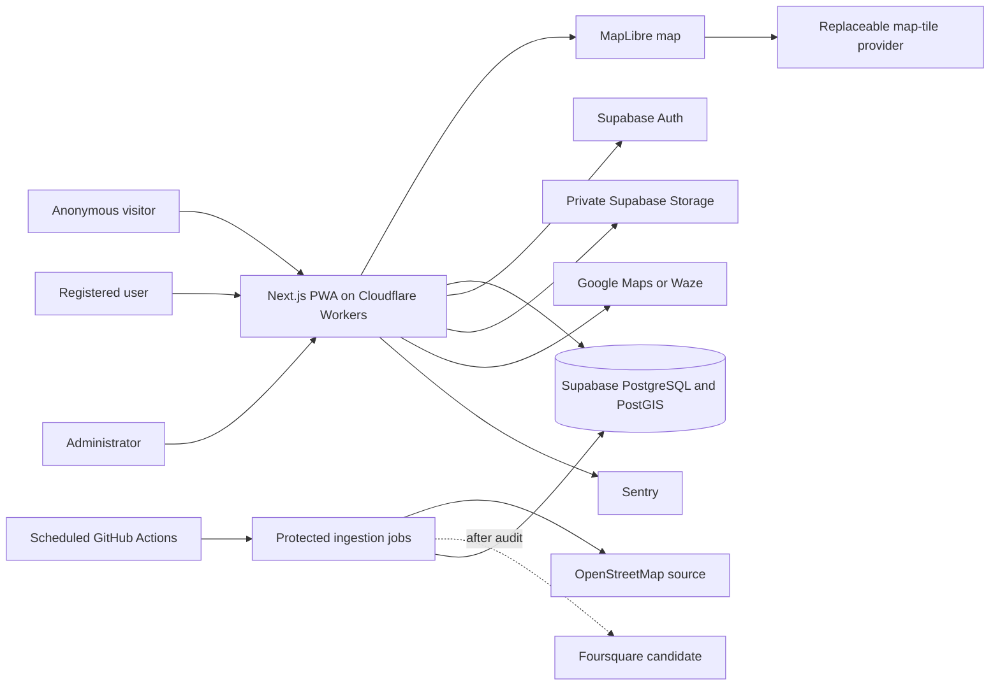
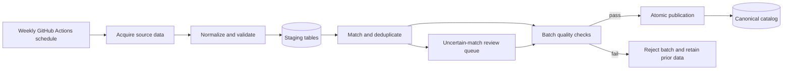
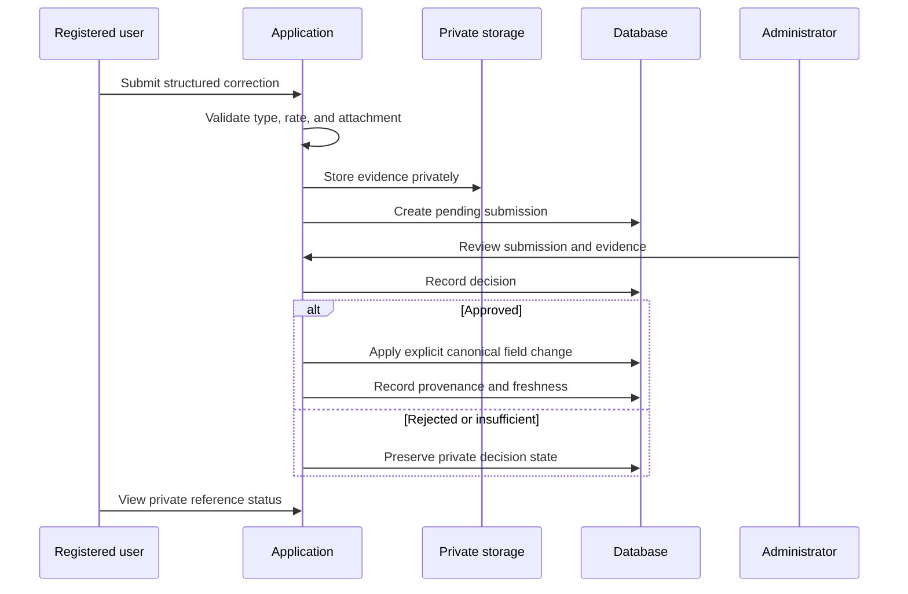

# Asa Ta Mangaon? System Architecture

## Document control

| Field | Value |
| --- | --- |
| Product | Asa Ta Mangaon? |
| Descriptor | Tagum Food Finder |
| Document status | Approved |
| Discovery status | Complete |
| Last updated | 2026-10-13 |
| Approved | 2026-10-13 |
| Target milestone | Private beta in February 2027 |
| Product owner | Repository owner |
| Build model | Solo-built |

This document defines the approved technical architecture for the Tagum City private beta. It translates the requirements in [`prd.md`](./prd.md) into system boundaries, runtime responsibilities, data flows, deployment choices, and operational rules.

Detailed table definitions belong in `data.md`. Detailed threat controls, privacy procedures, and incident response belong in `security.md`. Visual tokens and interaction specifications belong in `design-system.md`.

## Architecture goals

1. Deliver the private-beta scope without creating unnecessary operational work for one developer.
2. Keep public discovery fast and usable without an account.
3. Treat PostgreSQL as the canonical application datastore while retaining field-level source provenance.
4. Support geospatial search, filtering, and deterministic ranking without an external search service.
5. Isolate external place and map providers behind adapters so licensing, coverage, or price changes do not require a product rewrite.
6. Protect location, account, moderation, and attachment data using least privilege.
7. Stay within the ₱3,000 monthly operating ceiling and require approval before paid upgrades.
8. Preserve clear paths from private-beta scale to public service scale.

## Scope and scale posture

The initial architecture is optimized for a controlled private beta, not for 50,000 simultaneous users. It must nevertheless avoid decisions that prevent later growth.

The beta posture is:

- one application repository;
- one deployable PWA with public, authenticated, and administrative surfaces;
- managed PostgreSQL rather than a custom database service;
- background batch ingestion rather than live provider aggregation on every user request;
- deterministic SQL-backed search and ranking rather than AI or a dedicated search cluster;
- replaceable providers rather than provider-specific domain models;
- free or low-cost plans during validation, with explicit production-readiness gates.

Scaling should be driven by measured load. The first upgrade path is vertical and managed: move Supabase to Pro, raise Cloudflare limits, and adopt a paid or self-hosted map-tile plan. Splitting the application into microservices is not an anticipated early scaling step.

## Approved technology stack

| Concern | Approved choice | Reason |
| --- | --- | --- |
| Web application | Next.js with TypeScript | PWA delivery, public place pages, server rendering where useful, and shared types |
| Application shape | Modular monolith in one repository | Lowest coordination and deployment burden for a solo developer |
| Hosting | Cloudflare Workers | Commercially usable low-cost path; deployment compatibility must pass Stage 0 |
| Database | Supabase PostgreSQL | Managed relational store with authentication and storage integration |
| Geospatial data | PostGIS | Boundary checks, distance sorting, nearby queries, and geospatial indexes |
| Authentication | Supabase Auth | Email magic link and Google sign-in |
| Object storage | Private Supabase Storage buckets | Evidence attachment access can follow database authorization |
| Interactive map | MapLibre | Open renderer with provider portability and marker clustering support |
| Initial basemap | MapTiler during eligible private evaluation | Fastest beta path; provider remains replaceable |
| Place seed data | OpenStreetMap | Lawful baseline place coverage with required attribution |
| Enrichment candidate | Foursquare Places | Used only after coverage, licensing, retention, and cost audit passes |
| Search | PostgreSQL full-text, trigram/fuzzy matching, and PostGIS | Adequate for city-scale discovery without another service |
| Scheduled ingestion | GitHub Actions invoking protected ingestion jobs | Observable, versioned, and inexpensive weekly automation |
| Error monitoring | Sentry free tier | Actionable client/server errors with required data scrubbing |
| Product analytics | Minimal first-party events in PostgreSQL | Purpose-limited measurement and direct retention control |
| Bot protection | Rate limits, honeypot, and conditional Cloudflare Turnstile | Low-friction normal use with escalation for suspicious activity |

Dependency versions are not frozen in this document. Exact versions must be selected from current stable releases when the application is scaffolded, recorded in the package and lock files, and verified against Cloudflare's supported Next.js deployment path.

## High-level system

The browser never receives provider secrets, Supabase service-role credentials, administrative credentials, or unrestricted storage access.

## Repository and module boundaries

The repository contains one product, but the code must keep responsibilities separate. The intended logical modules are:

- `public discovery`: map, list, place profile, filters, location handling, and navigation handoff;
- `decision tools`: spin wheel, anonymous local persistence, and account-saved lists;
- `identity`: session handling, account settings, favorites, and account deletion;
- `community`: structured corrections, evidence uploads, and private submission status;
- `administration`: moderation queue, place management, duplicate resolution, taxonomies, and import review;
- `catalog`: canonical place reads, price bands, categories, occasions, evidence-backed attributes, and provenance;
- `ranking`: filter evaluation, distance calculation, match classification, and explanation codes;
- `ingestion`: provider adapters, normalization, validation, matching, staged imports, and publication;
- `analytics`: purpose-limited event capture and aggregation;
- `platform`: authentication, authorization, storage, configuration, monitoring, and provider clients.

These are module boundaries inside the modular monolith, not separately deployed services. Cross-module access should occur through explicit functions, server endpoints, database functions, or documented views rather than arbitrary table access.

## Application surfaces

### Public surface

The public surface supports anonymous use and includes:

- map and list discovery;
- manual or GPS-based location;
- filters and deterministic ranking;
- place profiles;
- external navigation handoff;
- anonymous spin-wheel use;
- local recent-place and preference persistence.

Public reads use restricted database views or narrowly scoped PostgreSQL functions. They must never reveal private submission data, internal moderator notes, user identifiers, raw evidence locations, or provider-only fields that cannot be redistributed.

### Registered surface

The registered surface adds:

- cloud favorites;
- saved wheel lists;
- structured correction submissions;
- private evidence uploads;
- private submission-status access;
- account settings, data access, and deletion controls.

### Administrative surface

The administrative interface is a protected section of the same application. It is not a separate deployment and must not rely on hidden URLs for security.

Administrator access requires:

- Google authentication;
- an allowlisted administrator identity;
- an administrator role enforced by the database;
- multi-factor authentication when supported by the selected authentication configuration;
- server-side and row-level authorization on every privileged operation.

## Browser and server responsibilities

### Browser responsibilities

The browser may:

- request geolocation after an explanatory prompt;
- hold the current coordinates in memory for the active experience;
- render the map and clustered markers;
- store anonymous wheel lists, recent places, and non-sensitive preferences locally;
- call public read views and approved functions;
- upload validated evidence using short-lived authorized storage operations;
- open external navigation links.

The browser must not:

- retain location history;
- contain provider or service-role secrets;
- make privileged import or moderation decisions;
- decide whether a dietary, halal, price, or verification claim is publishable;
- directly mutate canonical place data.

### Server responsibilities

Server-side routes, actions, or protected jobs handle:

- privileged writes;
- submission creation and validation;
- evidence authorization;
- moderation actions;
- account deletion orchestration;
- provider API calls containing secrets;
- import staging, validation, and publication;
- analytics validation and aggregation;
- cost and quota checks where provider support permits them.

### Database responsibilities

PostgreSQL and PostGIS enforce:

- stable canonical identifiers;
- referential integrity;
- row-level security;
- Tagum boundary checks;
- nearby and distance queries;
- fuzzy and full-text search;
- deterministic ranking inputs;
- source provenance relationships;
- moderation and import state transitions;
- uniqueness and duplicate-prevention constraints where deterministic.

## Domain data architecture

Detailed columns and constraints will be specified in `data.md`. The architecture requires the following logical groups.

### Canonical catalog

- places;
- place locations and the official Tagum boundary;
- place categories and cuisines;
- craving tags;
- occasion tags;
- evidence-backed dietary and religious attributes;
- contact and operating information;
- price ranges, tiers, confidence, and freshness;
- lifecycle state, including active, temporarily closed, permanently closed, and merged;
- public verification state.

Every canonical place uses an application-owned UUID. External identifiers are aliases and never primary keys.

### Source and provenance layer

- provider source records;
- external identifiers;
- normalized source fields;
- field-level provenance;
- source retrieval and freshness metadata;
- license or redistribution classification;
- import batches and validation results;
- duplicate-match candidates and decisions.

A canonical place may combine coordinates from one allowed source, a price band from accepted community evidence, and a category from another allowed source. Each published field must retain its own provenance rather than assigning one blanket source to the whole place.

### Community and moderation layer

- submissions and structured proposed changes;
- evidence metadata;
- private attachment references;
- moderation decisions and private notes;
- status history;
- accepted field provenance;
- abuse and duplicate indicators.

No submission directly updates the public catalog. Acceptance produces an explicit, auditable canonical change.

### User-owned layer

- minimal account profile;
- favorites;
- saved wheel lists and entries;
- consent and account-deletion state;
- the user's own submission references.

Anonymous wheel and recent-place data remain device-local.

### Analytics layer

- validated, purpose-limited raw events;
- daily aggregate measurements;
- event schema version;
- retention and deletion jobs.

Raw events exclude precise coordinates and are deleted after 30 days. Aggregated, non-identifying measurements may be retained for product trend analysis.

## Price architecture

The price model represents expected per-person spend for one ordinary meal plus a standard non-alcoholic drink where applicable. It excludes delivery charges, alcohol, and optional service charges. Known mandatory service charges may be incorporated into matching.

### Public representation

The initial PHP bands are:

| Tier | Range |
| --- | --- |
| Budget | Under ₱100 |
| Affordable | ₱100–₱199 |
| Moderate | ₱200–₱349 |
| Upper mid-range | ₱350–₱599 |
| Premium | ₱600 and above |

The stored model supports a minimum, maximum, tier, source, confidence, sample count, verification state, and freshness state. A range is preferred over one false-precision average.

### Source priority

Price evidence is resolved in this order:

1. owner-confirmed evidence when owner claims are implemented;
2. approved evidence-backed community reports;
3. a licensed provider value permitted for the intended use;
4. a category-based system estimate.

System estimates are allowed only as provisional, low-confidence values and must be labeled `Estimated`. They never count as verified price matches.

### Multiple reports

Multiple accepted community reports are combined using a median-based method with outlier detection and a recorded sample count. Exact calculation rules and minimum sample thresholds belong in `data.md`.

### Freshness

Verified price confidence remains current for six months. After that, it degrades to a stale state until reconfirmed. Historical values remain internal where needed for provenance; the interface must not imply current accuracy from expired evidence.

When no defensible value exists, the product displays `Price information unavailable` and excludes the place from strict budget matches. It does not hide the place from the unfiltered map.

## Geospatial architecture

### Boundary

The system stores a reviewed, versioned polygon representing the official Tagum City boundary and its source. Import validation excludes candidate places outside this polygon even if a provider labels them as Tagum.

### User location

The browser requests current location only after explaining why. Coordinates are used transiently for the active experience and are not written to location-history tables, analytics, logs, or error reports.

If GPS is denied or unavailable, the user can:

- search Tagum barangays or known places from the app-owned database; or
- select a point on the map.

No paid geocoder is required for the MVP fallback.

### Nearby ranking

PostGIS calculates straight-line geographic distance from the selected point. This distance is used for proximity ranking and display. The application does not request a route matrix for every result.

When the user asks for directions, the application builds an external destination link. Google Maps and Waze are supported, and a registered or local preference remembers the user's choice. The external service calculates actual travel routing.

### Map rendering

MapLibre renders the base map and an application-owned GeoJSON or vector result layer. Marker clustering occurs client-side for the beta unless profiling demonstrates a need for server-side clustering.

The map-provider boundary supplies style, tiles, attribution, and permitted configuration. Product place records never depend on tile-provider identifiers.

MapTiler is the initial evaluation provider only if the beta remains eligible under its current terms. Before public or commercial launch, the owner must compare:

- the then-current MapTiler commercial plan;
- a self-hosted regional PMTiles basemap backed by Cloudflare storage and caching;
- any other compliant provider approved at that time.

The application must show all required OpenStreetMap and provider attribution.

## Search, filtering, and ranking

### Search

Search is implemented in PostgreSQL using:

- normalized searchable names and aliases;
- full-text search;
- trigram or equivalent fuzzy matching;
- category and taxonomy joins;
- PostGIS boundary and proximity conditions.

An external search engine is not part of the beta architecture. It may be introduced only if measured search quality or database load justifies the added cost and operational surface.

### Three-valued filter logic

Every filter-relevant field is evaluated as:

- `match`;
- `does not match`;
- `unknown`.

Unknown is never silently converted into false. Confirmed matches and unknown fallbacks are returned separately so the interface can accurately describe result quality.

### Deterministic ranking

Ranking uses versioned, configurable weights and the priority established in the PRD:

1. verified match to active filters;
2. proximity;
3. verification quality;
4. freshness;
5. useful profile completeness.

The ranking service returns machine-readable explanation codes such as:

- `verified_budget_match`;
- `verified_craving_match`;
- `closest_verified_option`;
- `occasion_match`;
- `relevant_data_unknown`;
- `estimate_only`.

The UI translates these codes into plain English. No generative AI is required for classification or recommendation in the MVP.

## Place ingestion architecture

### Provider adapters

Each source adapter performs four distinct steps:

1. acquire only data permitted by the source agreement;
2. preserve the source representation needed for traceability;
3. normalize fields into the internal source model;
4. submit normalized records to the staging pipeline.

Adapters must not write directly to public canonical tables.

### Initial sources

OpenStreetMap is the initial baseline. The exact permitted extraction mechanism is selected during Stage 0 based on coverage, reliability, and usage policy; the production application does not query community map infrastructure on every page load.

Foursquare remains a candidate enrichment adapter. It is disabled for production ingestion until the 100-place audit confirms:

- at least 80 sampled places are found;
- at least 95% of returned places have usable coordinates;
- duplicates and permanently closed records remain below 5%;
- requested fields may be retained and displayed as designed;
- ongoing API cost fits the ceiling;
- required attribution and correction obligations are implementable.

Foodpanda is not an ingestion provider. Its documented APIs are partner-scoped and do not provide an authorized city-wide discovery feed.

### Batch pipeline

The weekly schedule supports an authorized manual run for urgent revalidation. Import credentials live only in GitHub or platform secret stores.

### Validation and publication

A batch must validate:

- source and license metadata;
- coordinate validity;
- Tagum boundary inclusion;
- required identity fields;
- category mappings;
- malformed or unexpectedly missing fields;
- duplicate likelihood;
- abnormal count changes;
- closed or moved-place indicators;
- provider quota consumption.

Valid data is staged before publication. A batch becomes visible atomically only after its quality checks pass. A failed batch leaves the last valid catalog intact and creates an operator-visible failure record.

Compact batch metadata and changed source records are retained. Unlimited raw provider responses are not retained, especially where the license or storage policy does not permit it.

### Matching and duplicates

Candidate records are matched using external aliases where known and a combination of normalized name, location distance, address, contact, chain, and category. High-confidence matches may resolve automatically. Ambiguous candidates enter the administrator's duplicate-review queue.

Merged or closed canonical records are soft-deleted from ordinary discovery and retain redirects, aliases, and decision history needed to prevent re-creation on later imports.

### Source precedence

When allowed sources disagree, canonical resolution follows:

1. verified owner or administrator decision;
2. approved community evidence;
3. the freshest permitted provider value;
4. OpenStreetMap baseline data.

Precedence operates per field, not per place.

## Community correction flow

Evidence uploads are limited to JPEG, PNG, and WebP, with a maximum size of 5 MB per file. The upload path validates the actual media type, removes image metadata, applies randomized storage identifiers, and keeps objects private.

Accepted evidence is not automatically made public as media. Publishing an image requires a separate rights and moderation decision.

Retention rules are:

- rejected evidence: delete after 90 days unless tied to an active abuse investigation;
- accepted evidence: retain while needed for verification, then for one year after being superseded;
- after evidence deletion: retain only non-personal provenance and moderation facts required for catalog integrity;
- account deletion: remove identity and private files while retaining approved public corrections in anonymized form.

## Authentication and authorization architecture

### Sign-in

Supabase Auth provides:

- email magic links;
- Google sign-in;
- managed sessions;
- account identity for cloud-owned data and submissions.

The application collects only the account information required for authentication, saved data, moderation follow-up, and account operations.

Supabase's default email capability may be used during local development. A dedicated SMTP provider must be configured before external beta invitations.

### Authorization

Authorization is enforced at multiple layers:

- route and server-action checks for user experience and early rejection;
- PostgreSQL row-level security as the authoritative data boundary;
- private storage policies tied to the uploader and administrator;
- administrative role checks for canonical changes;
- service-role access limited to controlled server and ingestion contexts.

Primary roles are `anonymous`, `authenticated`, and `administrator`. A future owner role may be represented in the schema, but owner-claim workflows are not implemented in the MVP.

### Abuse controls

Submission endpoints apply:

- authenticated-account requirements;
- per-account and per-network rate limits;
- duplicate-submission detection;
- a hidden honeypot field;
- conditional Turnstile challenges when behavior is suspicious;
- attachment type and size validation;
- generic error messages that do not disclose moderation or account internals.

## Privacy architecture

### Location

Precise current coordinates remain in the active browser experience. They are not stored in the account, raw analytics, request logs under application control, Sentry payloads, or moderation data.

Analytics may record coarse outcomes such as `location_permission_succeeded` or `manual_location_used`, but not the selected coordinates.

### Analytics

The beta stores only the events required by the PRD. Events use a documented schema and avoid free-form payloads. Anonymous use receives a rotating, non-identifying session identifier rather than cross-device identity.

Raw events are aggregated on a schedule and deleted after 30 days. Aggregate statistics must not contain combinations that reasonably identify an individual.

### Logs and errors

Application logging uses structured allowlists. Sentry configuration must scrub:

- latitude and longitude;
- authentication tokens and cookies;
- magic-link parameters;
- email addresses where not essential;
- attachment URLs and storage paths;
- request bodies containing submissions;
- provider credentials and authorization headers.

### Account lifecycle

Registered users can request account deletion. The deletion process:

1. revokes active sessions;
2. deletes private profile data, favorites, saved wheels, pending submissions where lawful, and private attachments;
3. anonymizes accepted public contributions needed for catalog provenance;
4. records only the minimal non-identifying completion audit required for operations.

Exact legal notices and request timelines will be established in `security.md`.

## PWA and offline architecture

The PWA includes:

- a web app manifest;
- an application-shell service worker;
- installability metadata;
- explicit online, offline, loading, and stale states;
- versioned cache invalidation;
- local storage for recent place summaries, anonymous wheels, and preferences.

Offline storage does not contain the complete Tagum catalog. Fresh discovery, map tiles not already cached by the browser, authentication, submission, and routing require connectivity.

Cached place summaries must show that they may be stale. Sensitive account or moderation responses must not be placed into general-purpose service-worker caches.

## Deployment architecture

### Environments

The system has three environments:

- `local`: local application and development services;
- `staging`: production-like integration, migration, and deployment validation;
- `production`: private-beta user environment.

Staging and production use separate Supabase projects and configuration. Secrets and data must not be copied between them casually. Test fixtures must not contain real user information.

### Cloudflare deployment gate

Before application scaffolding is considered stable, a deployment spike must verify the current Cloudflare-supported Next.js path for:

- App Router behavior;
- server rendering and route handlers used by the design;
- Supabase authentication callbacks;
- environment and secret handling;
- PWA service-worker delivery;
- caching semantics;
- image handling;
- error reporting;
- local production-runtime preview.

If a required feature is unsupported or unreliable, the owner must approve a hosting or framework change. The implementation must not silently accumulate provider-specific workarounds.

### Continuous delivery

Pull requests and protected-branch changes run:

- formatting and static analysis;
- type checking;
- unit tests;
- database migration validation;
- integration tests;
- the small critical-path end-to-end suite;
- dependency and secret scanning when configured;
- a staging deployment or preview appropriate to the hosting plan.

Production deployment requires explicit owner approval. A source commit alone does not deploy automatically to production.

### Database migrations

Database changes are versioned migrations committed with the application. Migrations are tested against a disposable or staging database before production. Destructive schema changes require a backup, a documented data migration, and a rollback or roll-forward strategy.

## Testing architecture

### Unit tests

Unit coverage prioritizes:

- provider normalization;
- price-band classification;
- three-valued filter logic;
- ranking and explanation codes;
- distance helpers;
- duplicate-match scoring;
- retention-date calculation;
- external navigation-link generation.

### Integration tests

Integration coverage prioritizes:

- row-level security policies;
- public views and protected writes;
- authentication callback behavior;
- evidence upload authorization;
- moderation state transitions;
- import staging and atomic publication;
- Tagum boundary inclusion;
- account deletion behavior;
- analytics payload rejection and retention.

### End-to-end tests

The critical-path suite covers:

1. anonymous location fallback to discovery and route handoff;
2. filtering with verified matches and unknown fallbacks;
3. account sign-in and favorite persistence;
4. correction submission with evidence;
5. administrator moderation and canonical publication;
6. offline application-shell and recent-place behavior.

Manual testing remains necessary for real-device geolocation permissions, PWA installation, external navigation handoff, and accessibility checks on representative Android and iPhone devices.

## Browser and platform support

The beta supports the current and previous major versions of:

- Chrome;
- Safari;
- Edge;
- Firefox.

Testing priority is Android Chrome followed by iPhone Safari. The responsive web experience must remain usable without installation. Unsupported PWA installation behavior must not block browser-based discovery.

Internally, timestamps are stored in UTC. User-facing time and schedules use `Asia/Manila`. Monetary values use Philippine pesos and integer centavo-safe representations rather than floating-point currency arithmetic.

## Monitoring and operations

### Error monitoring

Sentry receives scrubbed client and server exceptions. Release identifiers connect errors to deployed commits. Alerts prioritize:

- repeated route or search failures;
- authentication callback failures;
- import failures;
- moderation write failures;
- evidence upload failures;
- boundary or ranking query failures.

### Health and data-quality monitoring

Operational checks track:

- application availability;
- database availability and capacity;
- ingestion batch status and record-count anomalies;
- stale catalog proportions;
- duplicate-review backlog;
- moderation backlog;
- attachment storage use;
- raw analytics deletion;
- provider quota and spend;
- backup completion and restoration tests.

### Graceful degradation

| Failure | Required behavior |
| --- | --- |
| Place provider unavailable | Serve the last valid imported catalog and flag operator-visible staleness |
| Foursquare quota reached | Stop enrichment calls; retain OSM and canonical data |
| Map-tile provider unavailable | Preserve non-map list discovery where possible and show a clear map error |
| GPS unavailable | Offer database-backed manual location and map pin |
| Analytics unavailable | Do not block the product journey |
| Sentry unavailable | Continue operating with local structured logging |
| Evidence storage unavailable | Preserve form state where safe and ask the user to retry; do not create a misleading complete submission |
| Import validation fails | Reject the batch and keep the previous published dataset |
| External navigation application unavailable | Offer another supported provider or copy/open a standard destination link |

## Backup and recovery

Supabase Free does not supply the production backup posture required for a mature public service. During the private beta, a scheduled job creates a weekly encrypted export of app-owned database data and stores it outside the repository and outside the primary database project.

Backups must never be committed to Git or placed in public object storage. Backup credentials use a dedicated least-privilege secret.

Private-beta targets are:

- recovery point objective: no more than 24 hours of data loss;
- recovery time objective: service restoration within 48 hours.

Because a weekly export alone cannot meet the 24-hour target, the beta launch checklist must add a daily incremental or full encrypted export before real user corrections are accepted. Weekly restoration tests or automated integrity checks are excessive for the beta; restoration must instead be tested before launch and after material backup-process changes.

Moving to Supabase Pro is the preferred first production-readiness upgrade because it adds managed daily backups and removes free-project pausing. Point-in-time recovery remains a later risk-based decision.

## Cost architecture

The monthly infrastructure ceiling is ₱3,000. No paid upgrade or provider with automatic overage may be enabled without owner approval.

### Private-beta posture

| Service | Initial posture | Cost control |
| --- | --- | --- |
| Cloudflare Workers | Free allocation if compatibility and limits suffice | Request monitoring; paid plan requires approval |
| Supabase | Free staging and production projects | Capacity monitoring; external encrypted backups |
| MapTiler | Evaluation use only when eligible | Hard usage limit; confirm terms before invitations |
| Foursquare | Audit usage only until approved | Call cap, field minimization, and no production dependency |
| Sentry | Free tier | Event sampling and payload scrubbing |
| GitHub Actions | Included allowance | Weekly schedule and bounded jobs |

### Upgrade order

When reliability or usage requires spending, evaluate in this order:

1. database reliability and backups;
2. compliant public map delivery;
3. application compute;
4. place-data enrichment;
5. monitoring retention.

The architecture does not assume that all paid entry plans can coexist under the initial ceiling. Before public/commercial launch, the owner must choose a combination that fits the then-current budget or explicitly revise the ceiling.

All providers with overage billing must use spend caps, quota alerts, or fail-closed limits where available.

## Delivery stages and gates

### Stage 0A: Deployment feasibility

Verify:

- Next.js deployment on Cloudflare;
- PWA behavior on representative mobile browsers;
- Supabase authentication callbacks;
- PostGIS availability and query behavior;
- MapLibre with the evaluation tile provider;
- secret isolation and environment separation.

Failure requires an explicit architecture revision before product implementation continues.

### Stage 0B: Data audit

Build a repeatable audit harness and evaluate 100 representative real Tagum food places against the PRD gate. Produce coverage, coordinate, duplicate, closure, category, price-tier, license, and cost findings.

Do not interpret the audit as manual onboarding. It determines whether OSM plus Foursquare is viable and which fields require community enrichment.

### Stage 0C: Experience prototype

Validate:

- permission-aware GPS acquisition;
- barangay/place fallback and map pin;
- marker clustering;
- geographic nearest-place calculation;
- external Google Maps and Waze handoff;
- budget-range presentation;
- confirmed-match versus unknown-fallback behavior.

### Stage 1: Private-beta MVP

Implement the full approved MVP only after Stage 0 gates pass or the PRD and architecture are explicitly revised.

### Public/commercial readiness review

Before moving beyond a controlled evaluation beta, confirm:

- production hosting terms;
- commercial map-tile rights and expected cost;
- Supabase production plan and backup guarantees;
- Foursquare production license and retention rights if used;
- dedicated SMTP delivery;
- privacy and legal documents;
- domain, monitoring, abuse, moderation, and incident readiness;
- sustained compliance with the ₱3,000 ceiling or an approved budget revision.

## Architecture decision summary

| Decision | Outcome |
| --- | --- |
| Architecture style | Modular monolith |
| Primary client | Installable Next.js PWA |
| Primary datastore | Supabase PostgreSQL with PostGIS |
| Canonical data | App-owned normalized records with field-level provenance |
| Public access | Restricted views/functions plus protected server operations |
| Place acquisition | Batch import, not live per-request aggregation |
| Initial source | OpenStreetMap |
| Candidate enrichment | Foursquare after the 100-place audit |
| Map renderer | MapLibre |
| Initial tiles | MapTiler evaluation with replaceable provider boundary |
| Search | PostgreSQL full-text/fuzzy search and PostGIS |
| Ranking | Deterministic, versioned, explainable scoring |
| Price model | PHP per-person range, tier, confidence, source, and freshness |
| Authentication | Email magic link and Google |
| Authorization | Row-level security plus server checks |
| Administration | Protected section of the same application |
| Ingestion schedule | Weekly GitHub Actions with authorized manual runs |
| Publication | Staged validation and atomic publish |
| Location privacy | Transient current location; no history |
| Offline scope | App shell, preferences, recent places, and anonymous wheels |
| Analytics | Minimal first-party events; raw deletion after 30 days |
| Deployment | Staging checks; explicit production approval |
| Initial scale | Controlled private beta |
| Cost control | ₱3,000 ceiling with approval-gated upgrades |

## Time-sensitive provider references

Provider capabilities, prices, quotas, and terms can change. Recheck these official sources at the deployment and public-readiness gates:

- [Cloudflare Next.js deployment documentation](https://developers.cloudflare.com/workers/framework-guides/web-apps/nextjs/)
- [Cloudflare Workers pricing](https://developers.cloudflare.com/workers/platform/pricing/)
- [Supabase pricing](https://supabase.com/pricing)
- [Supabase billing documentation](https://supabase.com/docs/guides/platform/billing-on-supabase)
- [MapTiler Cloud pricing](https://www.maptiler.com/cloud/pricing/)
- [MapTiler Cloud terms](https://www.maptiler.com/terms/cloud/)
- [MapLibre documentation](https://maplibre.org/maplibre-gl-js/docs/)
- [OpenStreetMap copyright and license](https://www.openstreetmap.org/copyright)
- [Foursquare Places API overview](https://docs.foursquare.com/fsq-developers-places/reference/places-api-overview)
- [Foursquare Place Search](https://docs.foursquare.com/fsq-developers-places/reference/place-search)
- [Protomaps basemap downloads and licensing](https://docs.protomaps.com/basemaps/downloads)
- [Protomaps Cloudflare deployment](https://docs.protomaps.com/deploy/cloudflare)
- [Vercel Hobby plan restrictions](https://vercel.com/docs/plans/hobby)

## Architecture acceptance criteria

This architecture is ready for approval when the product owner confirms that:

1. the modular-monolith and managed-service approach is acceptable;
2. Cloudflare, Supabase, MapLibre, and the replaceable map-provider boundary are acceptable;
3. the Stage 0 deployment and 100-place data audits remain mandatory gates;
4. the price, provenance, moderation, privacy, backup, and cost decisions match the intended product;
5. no MVP implementation begins until the remaining required documents are completed and approved in sequence.

After approval, the next document is `design-system.md`. Its discovery must settle visual direction, interaction patterns, responsive behavior, accessibility targets, content style, and map/list presentation before that file is created.
