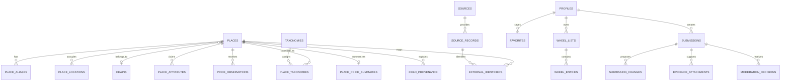

# Asa Ta Mangaon? Data Model

## Document control

| Field | Value |
| --- | --- |
| Product | Asa Ta Mangaon? |
| Descriptor | Tagum Food Finder |
| Document status | Approved |
| Discovery status | Complete |
| Last updated | 2026-10-13 |
| Approved | 2026-10-13 |
| Target milestone | Private beta in February 2027 |
| Product owner | Repository owner |
| Build model | Solo-built |

This document defines the approved canonical entities, field behavior, provenance model, validation rules, import mappings, retention periods, indexes, and migration strategy for the Tagum City private beta.

It implements the requirements in [`prd.md`](./prd.md), the boundaries in [`architecture.md`](./architecture.md), and the user-facing states in [`design-system.md`](./design-system.md). Security controls, threat analysis, privacy procedures, incident response, and exact authorization policies belong in `security.md`.

## Data goals

1. Keep one trustworthy canonical place catalog without hiding uncertainty.
2. Preserve field-level source and moderation history for every important published claim.
3. Support fast geospatial discovery, filtering, and deterministic ranking with PostgreSQL and PostGIS.
4. Prevent imports and community submissions from directly mutating public data.
5. Collect the minimum account and analytics data needed for the approved product.
6. Make user export, deletion, source replacement, and provider audits practical for one developer.
7. Keep the schema extensible without collecting speculative MVP data.

## Modeling conventions

### Names and identifiers

- Database objects use `snake_case`.
- Tables use plural names and columns use singular names.
- Important entities use application-owned random UUID primary keys generated by PostgreSQL.
- Sequential identifiers may exist internally for performance, but they are never exposed as public references.
- Public submission references are opaque, nonsequential values separate from database keys.
- External provider identifiers are aliases and never canonical primary keys.
- Editable vocabularies use taxonomy tables with stable slugs, labels, sort order, and active state.
- Stable workflow states use constrained text values. Adding a state requires a migration and application support.

### Time, money, and locale

- All event timestamps use `timestamptz` and are stored in UTC.
- The interface displays time in `Asia/Manila` unless the user environment requires a more appropriate representation.
- Calendar dates that do not represent an instant use PostgreSQL `date`.
- Durations and retention jobs are calculated from UTC timestamps.
- Money uses integer centavos and an ISO 4217 currency code. MVP application values use `PHP`.
- Percentage charges use integer basis points, where 100 basis points equals one percent.

### Shared lifecycle fields

Mutable domain tables normally include:

- `id`;
- `created_at`;
- `updated_at`;
- `created_by` and `updated_by` when an authenticated actor exists;
- `record_version`, incremented for optimistic concurrency;
- `deleted_at` and `deleted_by` when soft deletion applies.

Database triggers or one shared write layer maintain timestamps and record versions. Client-provided audit values are not trusted.

### Null and unknown semantics

`NULL` means unknown, not false, not zero, and not empty. Filter-relevant claims use explicit states so the product can distinguish:

- verified match;
- verified non-match;
- unknown;
- stale information.

Empty strings are normalized to `NULL`. A missing price, attribute, or operating-hour value is never inferred from category or absence alone.

## Domain overview

The diagram shows the principal relationships, not every reference or audit table.

## Reference and geographic data

### `city_boundaries`

Stores reviewed administrative boundaries used by validation and geospatial queries.

| Field | Type or behavior |
| --- | --- |
| `id` | UUID primary key |
| `slug` | Unique stable identifier, initially `tagum-city` |
| `name` | Official display name |
| `geometry` | PostGIS `geometry(MultiPolygon, 4326)` |
| `source_id` | Source registry reference |
| `source_version` | Provider or publication version |
| `effective_from` | Date this geometry became the approved boundary |
| `effective_to` | Nullable replacement date |
| `is_current` | One current boundary per slug |

Boundary replacement creates a new row. It does not overwrite the geometry used by earlier imports.

### `barangays`

Stores the official Tagum barangay vocabulary used for display, manual location, and address normalization.

Required fields are `id`, stable `slug`, official `name`, optional alternative names, optional reviewed geometry or point, `city_boundary_id`, `source_id`, and `is_active`. Barangay labels from external sources are mapped to these rows and are not accepted as uncontrolled canonical text.

### Taxonomy structure

`taxonomies` contains editable vocabularies with these `taxonomy_type` values:

- `place_category`;
- `cuisine`;
- `craving`;
- `occasion`.

Each row has a stable `slug`, display `label`, optional description, optional parent, sort order, and active state. Slugs remain reserved after retirement so links and historical records do not change meaning.

User free text never creates a taxonomy row automatically. Moderators map suggestions to an existing value or deliberately create a reviewed value.

## Canonical place catalog

### `places`

Each physical outlet is one place. Multiple outlets may belong to one chain.

| Field | Type or behavior |
| --- | --- |
| `id` | UUID primary key |
| `chain_id` | Nullable reference to `chains` |
| `canonical_name` | Required public name |
| `search_name` | Normalized generated or maintained search form |
| `lifecycle_status` | `draft`, `active`, `temporarily_closed`, `permanently_closed`, `moved`, `merged`, or `archived` |
| `verification_state` | Overall profile quality state, not a blanket verification badge |
| `primary_category_id` | Required before public activation |
| `merged_into_place_id` | Required when status is `merged` |
| `public_notes` | Nullable concise factual note |
| `activated_at` | First public publication time |
| `closed_at` | Nullable known closure time |
| `last_reviewed_at` | Last catalog-level review time |

Constraints prevent a place from merging into itself and require merge targets to be distinct canonical places. Closed, moved, merged, and archived records are retained indefinitely for redirects, duplicate prevention, and history.

### `chains`

Stores an optional shared brand identity across outlets. A chain has a UUID, canonical name, normalized name, aliases, and lifecycle state. It does not replace outlet-level location, price, hours, or attributes.

### `place_aliases`

Stores alternative spellings, former names, provider names, and normalized search aliases. Fields include `place_id`, `alias`, `normalized_alias`, `alias_type`, optional provenance, and active dates. A unique normalized alias per place prevents repeated aliases without assuming names are globally unique.

### `place_locations`

Location history is separate from the place identity.

| Field | Type or behavior |
| --- | --- |
| `id` | UUID primary key |
| `place_id` | Canonical place reference |
| `point` | PostGIS `geography(Point, 4326)` |
| `display_address` | Human-readable address |
| `address_line` | Structured street or locality text |
| `barangay_id` | Reviewed Tagum barangay |
| `postal_code` | Nullable normalized postal code |
| `location_precision` | `rooftop`, `entrance`, `parcel`, or `approximate` |
| `is_current` | One current location per non-merged place |
| `valid_from` and `valid_to` | Location history interval |
| `public_pickup_confirmed` | Required for home-based businesses |

A current public place must fall within the current approved Tagum boundary. Home-based businesses are published only when the pickup point is publicly advertised or owner-approved. The MVP does not publish approximate private-home locations.

Relocation preserves the same place when the business identity and outlet continuity are clear. A materially different outlet creates a new place.

### `place_contacts`

Stores one contact method per row using `contact_type` values `phone`, `email`, `website`, or `social`. It includes the normalized value, public display value, platform label when applicable, provenance, verification time, and active state.

Phone numbers are normalized to E.164 when possible. Only business-public contact information is stored. Personal contact details supplied solely for moderation communication remain private submission data and do not enter this table.

### `place_hours` and `place_hour_exceptions`

`place_hours` stores recurring weekly intervals with weekday, local opening time, local closing time, overnight flag, source, verification state, and effective dates. More than one interval per day is allowed.

`place_hour_exceptions` stores date-specific closures or replacement intervals. Exceptions take precedence over recurring hours. Both tables preserve provenance even though open-now filtering is deferred.

### `place_service_options`

Stores nullable, sourced states for `dine_in`, `takeaway`, `pickup`, and `delivery`. Each option uses `available`, `unavailable`, or `unknown` plus provenance and review time. Amenities such as Wi-Fi, parking, or outdoor seating are not collected during MVP.

### `place_taxonomies`

Many-to-many assignment table for secondary categories, cuisines, cravings, and occasions. Fields include `place_id`, `taxonomy_id`, assignment confidence, provenance, verification state, and review time.

The primary category remains on `places`. Cravings and occasions are curated many-to-many mappings. The public filter supports one active craving and one active occasion at a time, but this interaction rule does not limit stored assignments.

### `place_attributes`

Stores evidence-backed dietary, religious, and allergen-related claims. It includes:

- `place_id`;
- stable `attribute_slug`;
- `claim_state` as `verified_yes`, `verified_no`, or `unknown`;
- `evidence_class`;
- optional scope and caution text;
- source or accepted submission reference;
- `verified_at`, `review_due_at`, and `expired_at`.

Halal information uses distinct attribute values for `halal_certified`, `halal_business_stated`, and `halal_not_offered`. The interface provides separate certified and business-stated choices and labels results explicitly. Formal certification requires evidence identifying the certifying body and, when available, validity dates.

Allergen records describe specific claims and their scope. The system never infers or publishes a blanket `allergen-free` claim. Unknown is the default for every attribute not backed by evidence.

## Price model

### Price definition

Price represents the expected spend for one ordinary meal plus a standard nonalcoholic drink where applicable. It excludes delivery charges, alcohol, and optional charges. Currency is PHP for the MVP.

The public bands are derived from the current range:

| Tier | Stored range rule |
| --- | --- |
| Budget | Maximum below 10,000 centavos |
| Affordable | Representative range falls within 10,000 to 19,900 centavos |
| Moderate | Representative range falls within 20,000 to 34,900 centavos |
| Upper mid-range | Representative range falls within 35,000 to 59,900 centavos |
| Premium | Representative range begins at or exceeds 60,000 centavos |

The implementation must define one deterministic boundary rule for ranges crossing tiers and cover it with tests. The recommended rule assigns the tier from the midpoint while always displaying the actual range.

### `price_observations`

Accepted price evidence is immutable. Corrections create a new observation rather than editing history.

| Field | Type or behavior |
| --- | --- |
| `id` | UUID primary key |
| `place_id` | Canonical place reference |
| `minimum_centavos` | Nonnegative integer |
| `maximum_centavos` | Integer greater than or equal to minimum |
| `currency_code` | `PHP` for MVP |
| `observed_at` | Date the price was seen or confirmed |
| `source_id` | Nullable provider source |
| `submission_id` | Nullable accepted community submission |
| `observation_kind` | `community`, `provider`, `owner`, or `system_estimate` |
| `confidence` | `low`, `medium`, or `high` |
| `verification_state` | `pending`, `accepted`, `rejected`, `superseded`, or `expired` |
| `outlier_state` | `not_checked`, `clear`, `flagged`, or `reviewed` |
| `moderation_decision_id` | Required for community acceptance |

An accepted observation must identify its evidence path. System estimates are low confidence, remain labeled `Estimated`, and never become verified budget matches.

### `place_price_summaries`

Stores the current fast-read representation while retaining observations separately.

Fields include `place_id`, minimum and maximum centavos, derived tier, calculation method and version, accepted sample count, independent contributor/source count, confidence, verification state, calculated time, current-through date, and stale time.

Automatic aggregation requires:

1. at least three accepted observations;
2. observations from at least two independent accounts or sources;
3. observations no older than six months;
4. no unresolved flagged observation used in the result.

The aggregate is the median accepted lower bound and median accepted upper bound. If the resulting maximum is below the minimum because of unusual input distribution, the summary is held for moderator review rather than published.

With insufficient observations, a moderator may publish a clearly labeled estimate. Otherwise price remains unknown and the place is excluded from strict budget matches.

An observation is flagged, not automatically rejected, when its midpoint differs by more than 50 percent from the current median or when its range is internally suspicious. A moderator records the decision.

Summaries become stale six months after the newest accepted supporting observation. Historical accepted nonpersonal observations remain available for auditing and trends.

### `place_service_charges`

Stores a nullable charge in basis points, applicability notes, mandatory state, provenance, verification time, and review due date. Mandatory charges may be used by budget matching when their application is deterministic. Group totals are computed from group size and the per-person range and are not stored.

## Sources, provenance, and ingestion

### `sources`

One row represents a provider, official publication, approved community channel, or system estimate method. It records:

- stable slug and display name;
- source type;
- homepage and license URLs;
- attribution text;
- allowed collection, storage, display, modification, and redistribution flags;
- raw payload retention limit;
- refresh policy;
- terms review date and next review due date;
- active state.

An active ingestion adapter requires a completed rights record. Application code must not treat a source as usable merely because its endpoint is technically accessible.

### OpenStreetMap ODbL handling

OpenStreetMap-derived boundary and place data is maintained as a distinguishable source database with field-level provenance. Every public map or surface using that data displays `© OpenStreetMap contributors` and links to the OpenStreetMap copyright and ODbL information. A durable data-attribution page records the source snapshot and extraction date.

If the project publicly uses or distributes an adapted OSM database, that adapted database is offered under ODbL 1.0 as required. This database obligation does not by itself relicense application code, original editorial content, private user data, or records independently obtained under compatible terms; those materials remain logically and operationally separable. A refreshed OSM snapshot requires a new recorded checksum and review before publication.

The implemented baseline importer accepts only the approved, checksummed GeoJSON sequence and Tagum boundary fixture. It records the OSM snapshot version, SHA-256 checksum, adapter version, normalized content hash, boundary version, and ODbL classification. The first verified snapshot contains 176 in-boundary candidates: 174 usable-category records and two records held for category review. No price is inferred from OSM data.

The implemented Overture supplement accepts only a pinned, checksummed JSON Lines extraction and the same approved Tagum boundary checksum. It proposes creation only for usable categories with source confidence of at least `0.8`, excludes records reported permanently closed, and sends exact-name matches within 100 metres of an active place to moderation. Its release, content hashes, source timestamps, licensing classification, and attribution remain attached to the import. Overture does not establish current PHP menu prices, so the supplement does not infer price ranges.

The first production Overture batch published 117 reviewed creates and retained 594 records for moderation. Together with the 174-place OpenStreetMap baseline, the active immutable release exposes 291 attributed places. One obvious name/category contradiction was manually held before publication.

An inactive Foursquare server boundary can normalize an attributed description, price tier, refresh date, and up to five photo references for an already-known Foursquare place identifier. It does not search, persist, cache, download photos, or publish these fields until an account-specific terms review and public presentation design are approved. Foursquare tiers never become exact PHP prices.

A production identifier audit found no known Foursquare identifier among the 117 published Overture places. Nineteen private Overture moderation records have identifiers, but each remains below the approved automatic-publication confidence threshold. The system must not attach those provider details to a public place until the place relationship is explicitly reviewed.

### `source_records`

Stores normalized provider data separately from canonical places. Important fields are source, external record key, normalized payload, payload schema version, retrieval time, source update time, content hash, licensing classification, raw-payload expiry, and latest-seen batch. A changed content hash creates a new source-record version; it does not rewrite evidence already referenced by published provenance.

Normalized payloads contain only approved fields. Raw responses are stored only when source terms permit and are deleted after at most 30 days unless a stricter source limit applies. Secrets and request authorization data are never stored with source records.

### `external_identifiers`

Maps a canonical entity to a source record using source, entity type, external key, and optional source-record reference. The combination of source, entity type, and external key is unique. One canonical place may have many provider aliases.

### `field_provenance`

Connects an accepted canonical field to its origin without moving normal domain values into an entity-attribute-value model.

Each row records:

- canonical entity type and ID;
- approved field path;
- source record, price observation, submission change, or admin decision that supports it;
- accepted value hash;
- acceptance time and actor;
- confidence and verification state;
- valid and review-due times;
- superseding provenance row when replaced.

Only allowlisted field paths may be recorded. Canonical values remain in their typed domain tables for constraints, indexes, and fast reads.

### `import_batches`

Tracks scheduled and authorized manual imports. Fields include source, trigger type, start and finish times, status, adapter and schema versions, fetched/normalized/created/updated/unchanged/rejected counts, quota usage when available, validation summary, catalog release reference, and failure classification.

Statuses are `queued`, `acquiring`, `normalizing`, `matching`, `awaiting_review`, `validating`, `published`, `rejected`, or `failed`.

### `import_batch_records`

Links source records to a batch and records normalization state, boundary result, validation errors, content change, and proposed action. Compact batch metadata and changed normalized source records are retained; unchanged unlimited snapshots are not.

### `match_candidates`

Stores proposed source-to-place matches with score, model or rules version, contributing reasons, blocking conflicts, review state, reviewer, and final decision. Uncertain candidates enter the moderation queue. Only decided matches create external identifiers.

### `catalog_releases`

Represents an atomic public catalog publication. It records the included batch set, validation result, publication time, publisher, previous release, and rollback target. Failed batches never change the active release.

A source record disappearing from one import does not delete or close a canonical place. It creates a revalidation condition. Canonical lifecycle changes require corroborating evidence or moderation.

The implemented OSM workflow automatically publishes only first-seen records with a usable category. Ambiguous categories and changes to already-linked source records remain staged with a `moderate` action. Publication creates a complete immutable release, switches the single active release in one transaction, and is idempotent for the same source checksum and adapter version.

### Source precedence

Precedence is field-specific, not place-wide. The default order is:

1. approved, current evidence specific to the field;
2. current official or owner-confirmed evidence when owner claims are implemented;
3. approved community evidence;
4. licensed provider data permitted for the intended use;
5. a clearly labeled system estimate where the PRD permits one.

A lower-priority value may win when the higher-priority evidence is stale, incomplete, or outside its scope. The moderation decision must record the reason.

## Accounts and user-owned data

### `profiles`

Supabase `auth.users` is the identity authority. `profiles` stores only the application UUID reference, account status, theme preference, navigation-provider preference, notice and consent versions where applicable, locale, created time, and deletion state.

The MVP does not require a display name, public username, biography, avatar, birth date, age band, or public profile. Authentication email and Google or Facebook provider identity remain in the authentication system and are not duplicated into public application tables. The application does not import social graphs, contacts, birthdays, or provider profile content.

### `favorites`

Contains a unique active pair of `profile_id` and `place_id` plus creation time. Unfavoriting hard-deletes this convenience record. The product does not retain favorite/unfavorite history.

Anonymous favorites remain device-local. After sign-in, the user may explicitly migrate local favorites into the account.

### `wheel_lists`

Stores owner, private name, sort position, and timestamps. An account may keep at most 20 lists. Lists are private by default and are not shareable in the MVP.

### `wheel_entries`

Stores list, position, optional canonical `place_id`, required label snapshot, entry kind, and timestamps. An entry may reference a canonical place or be custom free text. The saved label preserves what the user saw when adding the item even if the canonical name later changes.

Each list supports at most 50 entries. Duplicate entries are allowed only after an explicit user action because the wheel gives each entry equal probability. Anonymous wheel state remains device-local and may be explicitly migrated after sign-in.

### `account_deletion_requests`

Tracks requested, confirmed, processing, completed, and failed states without storing credentials. Completion:

1. deletes favorites, wheel lists, wheel entries, private drafts, and other private convenience data;
2. removes or replaces the profile reference on accepted public contributions;
3. retains nonpersonal canonical provenance and moderation records needed for integrity;
4. removes the authentication identity through the authorized server workflow;
5. records only the minimum tombstone needed to prevent accidental restoration.

### Account export

The export is machine-readable JSON and includes account settings, favorites, saved wheel lists, submissions, decisions visible to the user, and relevant consent history. It excludes internal moderation notes, other users' data, provider-restricted data, and private system security signals.

## Community submissions and moderation

### `submissions`

One submission envelope contains the account, place when applicable, issue type, opaque public reference, status, user summary, policy version, rights-confirmation time, submitted time, and private follow-up state.

Statuses are:

- `draft`;
- `submitted`;
- `in_review`;
- `needs_information`;
- `partially_approved`;
- `approved`;
- `rejected`;
- `withdrawn`.

Submissions require an account but do not impose an age gate. The interface presents rights, evidence, and privacy explanations in language understandable to younger users. Abandoned drafts are deleted after 30 days.

### `submission_changes`

Each row proposes one typed field change within a submission. It stores an allowlisted change type, schema version, validated JSON payload, target entity and field, proposed value hash, review state, and accepted provenance reference.

The payload uses JSON because issue types have different shapes, but every change type has a versioned server-side schema. Arbitrary field names and unvalidated JSON are rejected. One submission may contain multiple related changes, and each may receive a separate decision.

### `evidence_attachments`

Stores private object key, original safe filename, MIME type, byte size, cryptographic content hash, image dimensions, upload state, malware-scan state when available, EXIF-removal state, rights confirmation, retention class, and deletion due date.

Rules:

- JPEG, PNG, and WebP only;
- maximum 5 MB per file;
- maximum five files per submission;
- server-verified MIME type and image decoding;
- EXIF removed before moderation access;
- duplicate hashes flagged for reviewer context;
- objects remain private and use short-lived authorized access.

Accepted evidence never becomes a public place image automatically.

### `moderation_decisions`

Append-only record of the moderator, submission change, decision type, public reason, private note, before and after value hashes, supporting evidence, and decision time. Decisions include approve, edit-and-approve, reject, request information, mark duplicate, merge, and insufficient evidence.

Direct administrative canonical edits create the same style of decision and provenance record. Published catalog state cannot be changed through an unaudited admin write.

### `submission_status_events`

Append-only history of submission state transitions with actor, time, reason code, and user-visible message. Application and database rules prevent invalid transitions.

## Public place media

### `place_media`

Public media is separate from submission evidence. Each record contains place, private original key, public optimized variant keys, media type, pixel dimensions, rights basis, source URL, attribution, alt text, sort order, publication state, and takedown time.

Originals remain private. The application serves generated responsive variants in approved formats. Media can be withdrawn without deleting its rights and moderation history. External images are not hotlinked unless the source explicitly allows that use and reliability risk is accepted.

The absence of media produces a neutral designed fallback, never a stock or generated food image presented as the real place.

## Analytics data

### `analytics_events`

Accepts only versioned, allowlisted event names and property schemas. Fields include event name, schema version, rotating pseudonymous session ID, event time, coarse client context, optional place ID, and validated properties.

Rules:

- the session identifier rotates at least every 24 hours and is not joined to account IDs;
- precise location and route origin are prohibited;
- raw free-text searches are prohibited;
- filters use taxonomy IDs or approved categorical values;
- route events may contain destination place, navigation provider, and coarse discovery context;
- unexpected properties are dropped or reject the event;
- raw events expire after 30 days.

### `analytics_monthly_aggregates`

Stores non-identifying counts grouped only by approved dimensions. Monthly aggregates are retained for 24 months, after which only annual totals remain. Small-cell suppression thresholds are defined in `security.md` before analytics reporting is implemented.

## Public and private read models

Public clients read restricted views or stable PostgreSQL functions rather than base tables.

### Public marker view

Provides only the fields required to render a bounded map result:

- place ID;
- name;
- point;
- primary category;
- lifecycle eligibility;
- compact price state;
- lightweight match inputs required by the request.

Marker queries require map bounds and an enforced maximum result size. Clustering keeps the rendered marker count bounded. Detailed profiles load separately.

### Public discovery view

Provides active discoverable place fields, current location, primary and secondary taxonomies, current price summary, safe contacts, current hours, service options, approved attributes, and public media. It excludes source-restricted fields, internal confidence notes, private evidence, user identity, and moderation metadata.

### Discovery result function

Accepts a selected point, map bounds, filters, and cursor. It returns:

- matching place summary;
- straight-line distance;
- confirmed-match and unknown-data flags;
- deterministic ranking score and version;
- explanation codes;
- next cursor.

Results use cursor pagination. The initial detailed list is capped at 50 items. Map markers use a lightweight bounds query and are not implemented by downloading the complete detailed catalog on every visit.

### Private account and moderation views

Account views expose only the current user's records. Moderation views are available only to authorized administrators and deliberately separate user contact, evidence, and abuse signals from the public catalog. Exact row-level policies belong in `security.md`.

## Validation rules

### Place publication

A place may become active only when it has:

- a nonempty canonical name;
- a primary category;
- one current point inside the approved Tagum boundary;
- a display address and reviewed barangay;
- at least one accepted source or moderation provenance path;
- no unresolved blocking duplicate candidate;
- a lifecycle state eligible for publication.

Price, hours, media, contacts, and dietary information are optional. Their absence is represented honestly.

### Text and links

- User and provider text is normalized for Unicode and whitespace before comparison.
- Original public spelling is preserved where appropriate.
- Search normalization is separate from display values.
- URLs are parsed, scheme-restricted, and normalized server-side.
- Notes have field-specific length limits and cannot contain active markup.
- User text never becomes SQL, HTML, a storage key, or a taxonomy identifier without validation.

### Geospatial data

- Longitude and latitude must be valid WGS84 coordinates.
- Public places must intersect the current Tagum boundary under the approved inclusion rule.
- Distance uses `geography` calculations in meters.
- Boundary and coordinate-source versions remain traceable.
- A bounding-box prefilter narrows candidates before exact distance checks.

### Workflow integrity

- Imports write to staging and normalized source tables before canonical publication.
- Submissions never update canonical fields directly.
- Moderation approvals execute the canonical change, provenance write, and decision record in one transaction.
- A catalog release becomes active atomically.
- Retention jobs record counts and failures without logging deleted personal content.

## Search and index strategy

The initial database indexes are:

- GiST on current place geography;
- GiST on current city and optional barangay geometries;
- GIN on a generated place search vector;
- trigram GIN or GiST on normalized canonical names and aliases;
- B-tree on active lifecycle state and primary category;
- composite indexes for place-taxonomy filtering;
- partial indexes for current locations, current prices, active taxonomies, pending moderation, and unexpired attributes;
- unique source/entity/external-key index;
- unique active profile/place favorite index;
- ordered indexes for wheel entries and moderation queues;
- timestamp indexes supporting every retention job.

Discovery first restricts by active lifecycle, boundary or radius, and requested filters, then computes exact distance and deterministic ranking. `ST_DWithin` is preferred over calculating distance for every row.

Materialized views are not introduced initially. Normal views and functions remain the default until measured query plans justify cached projections. New indexes require `EXPLAIN` evidence from representative synthetic or licensed datasets.

## Retention schedule

| Data | Retention |
| --- | --- |
| Active canonical places and provenance | While active and needed for service |
| Closed, moved, merged, and archived place history | Indefinite |
| Accepted nonpersonal price observations | Indefinite for audit and history |
| Raw provider payloads | Up to 30 days and only when permitted; stricter source terms win |
| Normalized current source records | While source is active or provenance requires them |
| Unchanged import snapshots | Not retained indefinitely |
| Abandoned submission drafts | 30 days |
| Rejected evidence attachments | 90 days after final rejection |
| Withdrawn submission attachments | 90 days after withdrawal unless deletion is requested sooner and no integrity hold applies |
| Accepted current evidence | While it supports a published claim |
| Superseded accepted evidence | One year after supersession |
| Moderation decisions and nonpersonal audit history | Indefinite |
| Private user convenience data | Until user deletion or account deletion |
| Raw analytics events | 30 days |
| Monthly analytics aggregates | 24 months |
| Annual non-identifying analytics totals | Indefinite |
| Completed account-deletion operational logs | Minimum period defined in `security.md` |

Retention jobs run on a documented schedule, are idempotent, and produce counts rather than content-bearing logs. A legal or security hold may pause deletion only under a policy defined in `security.md`.

## Data classification

| Class | Examples | Default exposure |
| --- | --- | --- |
| Public | Place profile, public point, category, current price summary, approved media | Restricted public views |
| Account-private | Favorites, wheel lists, preferences, export state | Owning account only |
| Submission-private | Proposed changes, evidence, follow-up messages | Submitter and authorized moderators |
| Operational-sensitive | Source rights records, import diagnostics, internal notes | Authorized administrators and jobs |
| Security-sensitive | Abuse signals, deletion controls, privileged audit details | Narrow server-side access only |

Every schema change identifies the class of new fields. Personal or sensitive fields are excluded from logs, analytics, client errors, and public database views by default.

## Migration and environment strategy

### Schema migrations

- All schema changes are source-controlled, ordered, and forward-only.
- A faulty deployed migration is corrected by a new migration rather than rewriting history.
- Destructive column or table removal uses expand, migrate, verify, contract stages.
- Data backfills are resumable, bounded, and observable.
- Production migrations run through the approved deployment workflow and require explicit production approval.
- Extensions, including PostGIS and trigram support, are enabled through migrations.

### Seeds and fixtures

- Stable taxonomies, status mappings, the Tagum boundary reference, and barangays use idempotent seed processes.
- Seed rows use stable UUIDs or slugs so environments agree.
- Local and CI customer or account fixtures are synthetic. A small immutable public reference fixture may use licensed real geography when its source version, checksum, license, attribution, and approval are committed with it.
- Real user submissions, attachments, identities, and production analytics are never copied into development fixtures.

### Environment parity

Local, staging, and production use the same migration history and schema. Configuration and data volume may differ. Staging provider records must be licensed for staging use or replaced with synthetic fixtures.

### Generated application types

TypeScript database types are generated from the migrated schema and verified in continuous integration. Domain validation schemas remain explicit because generated database types do not replace input validation or workflow rules.

## Backup and recovery data requirements

The data layer supports the architecture's daily recovery-point objective before real correction submissions begin. In addition to managed database backups, the system produces a weekly encrypted logical export containing canonical data, approved provenance, moderation history, and required reference data.

Exports exclude raw provider payloads when redistribution or storage terms prohibit them. Restore tests verify identifiers, geography, provenance relationships, and active catalog selection. Exact encryption, key handling, access, and restore procedures belong in `security.md`.

## Data quality operations

The administrator needs views for:

- active places missing coordinates, category, or provenance;
- points outside the current boundary;
- stale prices and attributes;
- duplicate candidates awaiting review;
- source records missing from recent imports;
- abnormal batch count changes;
- orphaned media or attachments;
- retention jobs that failed;
- active records referencing inactive taxonomy values;
- price summaries whose supporting observations no longer qualify.

Automated checks create review work; they do not silently delete or rewrite canonical data.

## Deferred data

The MVP does not model or collect:

- public ratings or reviews;
- orders, payments, reservations, or delivery transactions;
- route geometry or location history;
- social graphs or public profiles;
- owner-claim workflows;
- broad amenity inventories;
- menu-item catalogs;
- advertising profiles;
- cross-device anonymous tracking.

Schema extensibility does not authorize collecting these fields without product, privacy, and security review.

## Implementation gates

Before the data layer supports a private beta:

- [x] The Tagum city boundary is reviewed, licensed, checksummed, and versioned; the barangay source remains pending.
- [ ] Place activation constraints and merge redirects are tested.
- [ ] Price aggregation, outlier flagging, tier derivation, and staleness have deterministic tests.
- [ ] Every public field can identify its accepted provenance path.
- [ ] Import staging cannot mutate the active catalog before publication.
- [ ] Submission payloads have versioned validation schemas.
- [ ] Evidence metadata and retention dates are written at upload time.
- [ ] Public views exclude private, restricted, and internal fields.
- [ ] Account ownership constraints are covered by row-level security tests.
- [ ] Discovery queries use geospatial and search indexes under representative load.
- [ ] Raw analytics reject coordinates, account IDs, and free-text queries.
- [ ] Account export and deletion complete against synthetic end-to-end fixtures.
- [ ] Retention jobs are idempotent and observable.
- [ ] Generated TypeScript types match the migrated schema.
- [ ] Daily backup readiness and one restore test are complete before real corrections.

## Acceptance criteria

This data model is approved because the product owner confirmed the complete discovery decision set, including:

1. canonical place and outlet identity;
2. geography, boundary, address, and place lifecycle behavior;
3. editable taxonomies and evidence-backed attributes;
4. immutable price observations and median-based summaries;
5. source licensing, normalized records, imports, matching, and field provenance;
6. minimal accounts, favorites, wheel lists, export, and deletion;
7. typed correction submissions, private evidence, partial approval, and audit history;
8. separate public media, privacy-preserving analytics, retention, indexes, and migrations.

Security controls, authentication and session policy, authorization and row-level security, secret management, upload protection, abuse controls, privacy operations, monitoring, backup security, and incident procedures are defined in [`security.md`](./security.md).
