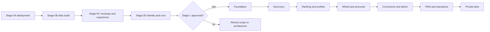

# Asa Ta Mangaon? Implementation Plan

## Document control

- Status: Approved requirements translated into executable work; Stage 0 not yet passed
- Date: 2026-10-13
- Delivery model: Solo-built, incremental, gate-driven
- Inputs: The five approved product documents and `stage-0-validation.md`

## Outcome

Deliver a controlled private-beta PWA that helps a person in Tagum choose a food place from current location, budget, craving, and occasion; explains the result honestly; hands the destination to an external navigation app; supports accounts, saved decisions, and moderated corrections; and operates within the approved privacy, security, data-quality, and PHP 3,000 monthly-cost constraints.

This plan intentionally separates validation from product construction. Stage 0 may produce disposable code and measurements. Stage 1 product code begins only after the blocking Stage 0 gates pass or the owner approves a documented revision.

## Working rules

1. Keep the product a modular monolith. Do not split services without measured need.
2. Deliver one vertical capability at a time and commit every significant change atomically.
3. Update `.vault/sessions/YYYY-MM-DD.md` with each significant repository commit.
4. Preserve provider boundaries for hosting, maps, place sources, email, navigation, and monitoring.
5. Keep exact dependency versions in the lockfile; do not copy version guesses from planning documents.
6. Write migrations before application code that depends on them.
7. Add or update tests in the same change as behavior.
8. Keep real credentials, provider exports, user data, and private evidence out of Git.
9. Run formatting, lint, types, relevant tests, build, and deployment checks in proportion to the change.
10. Do not implement a user-facing page before its mobile and desktop mockups have been shown to and explicitly approved by the owner.
11. Use the installed Taste skill suite for user-facing design and frontend implementation, subject to the accessibility and usability rules in `design-system.md`.
12. Do not use the unrelated `pickletagum-web-standards` skill.

## Page-by-page approval cycle

User-facing development proceeds one page at a time. Do not batch several pages into one design or implementation phase unless the owner explicitly requests it.

Each page follows this sequence:

1. Define the page's purpose, entry points, primary action, required states, and mobile and desktop scope from the approved product documents.
2. Produce and present readable mobile and desktop mockups for that page, including the material loading, empty, error, permission, and responsive states relevant to it.
3. Revise the mockups until the owner explicitly approves that page's visual direction. Mockup approval authorizes implementation of that page only.
4. Implement only the approved page and the supporting non-visual code needed for it. Material visual or interaction changes return to the mockup gate.
5. Verify behavior, responsiveness, accessibility, tests, and conformance with the approved mockups.
6. Present the implemented page for owner review and address requested corrections.
7. After owner acceptance, make a focused commit with the session-note update. Begin the next page only after that commit.

Repository, data, security, deployment, and other non-visual foundation work may proceed independently when it does not determine an unapproved page design.

## Delivery map



The Stage 0 tasks are ordered to expose expensive blockers early. Small independent investigations may overlap, but no overlap may conceal a failed gate.

## Stage 0: Validate before building

### 0.1 Repository validation foundation

Deliverables:

- package manager and runtime version policy;
- minimal workspace structure for a web application and validation tooling;
- formatting, linting, type-checking, unit-test, and build commands;
- `.env.example` containing names and descriptions only;
- ignore rules for datasets, reports containing restricted source rows, local database state, credentials, and generated artifacts;
- CI workflow bounded to the included GitHub allowance;
- `validation/README.md` explaining reproducibility and data-handling rules.

Acceptance:

- a clean checkout can install and run all repository checks;
- no secret is required for basic local checks;
- secret scanning and dependency review have an explicit path;
- the repository remains usable as the Obsidian vault.

Suggested commit sequence:

1. `chore: establish application toolchain`
2. `ci: add bounded validation checks`
3. `docs: define validation workspace`

### 0.2 Stage 0A deployment spike

Implement only the compatibility matrix in `stage-0-validation.md`.

Deliverables:

- minimal App Router application;
- selected PWA manifest and service-worker approach;
- Supabase browser and server client boundaries using non-production configuration;
- migration proving PostGIS boundary and nearest-place behavior with synthetic fixtures;
- Cloudflare preview and staging configuration;
- synthetic, scrubbed error-reporting test;
- deployment report and architecture decision record.

Constraints:

- the rendered UI is a test harness, not a product page;
- no real user or provider data;
- no production project, domain, or automatic deployment;
- no service-role credential in browser bundles or logs.

Decision:

- test the current `vinext` path first;
- test OpenNext only if the required matrix exposes a blocker;
- retain one adapter after the decision;
- stop for owner approval if neither path passes.

Suggested commit sequence:

1. `spike: verify nextjs cloudflare runtime`
2. `spike: verify supabase and postgis boundaries`
3. `spike: verify pwa and monitoring behavior`
4. `docs: record deployment feasibility decision`

### 0.3 Stage 0B data audit

Deliverables:

- Tagum boundary fixture with source and license metadata;
- source-neutral candidate schema;
- Foursquare OS Places snapshot adapter;
- OSM extract adapter;
- normalization and category-mapping functions;
- duplicate-candidate scorer;
- 100-place reference-sample schema and evidence rules;
- deterministic metrics command;
- machine-readable and Markdown audit reports;
- source-license and attribution record;
- go/no-go recommendation.

Implementation order:

1. Define fixture contracts and expected metric calculations in tests.
2. Add boundary clipping and coordinate validation.
3. Add Foursquare OS and OSM adapters independently.
4. Add normalization and category mapping.
5. Add candidate matching without automatic uncertain merges.
6. Assemble the stratified reference sample without importing it into the catalog.
7. Run the pinned audit and review outliers.
8. Record coverage, coordinate, duplicate, closure, category, price, license, refresh, and cost findings.

Acceptance is exactly the data launch gate in `prd.md` and `stage-0-validation.md`. Price availability is measured but is not allowed to fabricate a pass or hide unknown values.

Suggested commit sequence:

1. `test: define place audit contracts`
2. `feat: add tagum boundary validation`
3. `feat: add open place source adapters`
4. `feat: add place normalization and matching`
5. `docs: report tagum place source audit`

### 0.4 Stage 0C experience prototype

Design gate:

1. Treat the discovery map/list experience as the first page in the page-by-page approval cycle.
2. Produce mobile and desktop mockups for that page.
3. Show location permission, manual fallback, dense-marker, filtered-result, unknown-data, and map-failure states.
4. Wait for explicit owner approval before implementation.
5. Present the implemented page for owner acceptance before starting the next page.

Prototype deliverables after approval:

- transient geolocation controller with explanatory pre-prompt;
- manual barangay or map-pin fallback;
- MapLibre map with clustering against synthetic or approved audit data;
- geographic nearest-place calculation;
- list mode that remains useful when map tiles fail;
- Google Maps and Waze coordinate handoff;
- budget, craving, and occasion filter interaction;
- verified, probable, and unknown-fallback result treatments;
- PMTiles and eligible hosted-provider benchmark;
- real-device results and proposed performance budgets.

The prototype may be discarded or hardened after the test. It must not become production code merely because it looks complete.

Suggested commit sequence:

1. `docs: record approved discovery mockups`
2. `spike: validate location and map discovery`
3. `spike: validate filters and navigation handoff`
4. `docs: report experience and map benchmarks`

### 0.5 Stage 0D identity, email, privacy, and cost

Deliverables:

- custom SMTP delivery test with an authenticated sending domain;
- magic-link callback and replay/expiry behavior report;
- Google, Facebook, and Apple provider setup checklists;
- provider-disabled product behavior for unavailable providers;
- account linking, sign-out, reauthentication, deletion, and Apple relay tests;
- RLS test harness for anonymous, authenticated, owner, moderator, and administrator access;
- current monthly cost forecast and paid-threshold alerts;
- documented legal/privacy review status for minor access and evidence collection.

Apple sign-in is implemented when the enrolled developer account is available. Its absence is a failed MVP identity gate, not permission to remove the approved requirement silently.

Suggested commit sequence:

1. `spike: validate authentication callbacks`
2. `test: establish authorization policy harness`
3. `docs: record identity and email readiness`
4. `docs: approve stage one cost envelope`

### 0.6 Stage 0 decision

Create one decision record with links to all evidence. It must state one of:

- `GO`: all blocking gates pass;
- `CONDITIONAL GO`: named limitations are accepted by the owner with an expiry or follow-up gate;
- `NO GO`: Stage 1 is blocked pending an approved requirement or architecture change.

Do not use `CONDITIONAL GO` for an unresolved license, privacy, credential-exposure, or data-coverage failure.

## Stage 1: Private-beta MVP

Stage 1 begins only after the Stage 0 decision permits it.

### 1.1 Product foundation

Deliverables:

- final repository structure following the architecture module boundaries;
- environment-safe configuration with schema validation;
- initial database migrations for geography, catalog, provenance, taxonomies, and imports;
- generated database types;
- shared design tokens from `design-system.md`;
- base accessibility, error-boundary, loading, empty, and offline patterns;
- test factories using synthetic Tagum-like data.

Definition of done:

- migrations apply to an empty database and upgrade the previous state;
- public and private schemas are separated;
- RLS is enabled before tables receive application access;
- no page-specific UI is built in this slice.

### 1.2 Read-only catalog and discovery

Mockup approval is required before implementation.

Deliverables:

- first approved source import into staging;
- atomic catalog publication;
- restricted public marker and discovery views;
- discovery map and synchronized list;
- GPS and manual-location flows;
- nearest-place highlighting;
- visible-area search and clustering;
- map-unavailable list fallback;
- required source and map attribution.

Definition of done:

- anonymous discovery works without account creation;
- current position is kept transient and is not logged or persisted;
- stale or failed imports never replace the last valid catalog;
- representative keyboard, touch, screen-reader, and reduced-motion checks pass.

### 1.3 Search, filters, ranking, and place profiles

Mockup approval is required for filter/result states and the place-profile page.

Deliverables:

- full-text and fuzzy place search;
- budget, craving, occasion, and verified dietary/religious filters;
- three-valued match evaluation;
- deterministic ranking with explanation codes;
- no-result relaxation suggestions;
- place profile with provenance-safe public fields;
- opening-status rules and explicit unknown states;
- external navigation handoff.

Definition of done:

- strict budget matches use only accepted evidence;
- probable and unknown results are labeled distinctly;
- the same inputs and ranking version produce the same order;
- user-facing reasons match machine-readable explanation codes.

### 1.4 Spin wheel and anonymous persistence

Mockup approval is required for the wheel and its setup/results states.

Deliverables:

- create a wheel from current results or selected places;
- validate eligible entries and prevent misleading duplicates;
- animate a single-device selection with reduced-motion alternative;
- save anonymous lists locally;
- restore recent places and non-sensitive preferences;
- handle removed or closed saved places honestly.

Definition of done:

- the selected entry is determined independently from animation timing;
- no live multi-device synchronization exists;
- local data can be cleared from the product.

### 1.5 Accounts, favorites, and saved wheels

Mockup approval is required for sign-in, callback/error, saved-content, settings, export, and deletion states.

Deliverables:

- personal-email magic links through custom SMTP;
- Google, Facebook, and Apple sign-in;
- account linking and collision handling;
- cloud favorites and saved wheel lists;
- safe merge choice for anonymous local data after sign-in;
- data export and account deletion;
- reauthentication for destructive account actions.

Definition of done:

- authentication works with personal addresses and Apple private relay;
- public profiles, birth dates, contacts, social graphs, and provider content are not collected;
- users can access only their own private records;
- deletion removes or anonymizes data according to `data.md` and `security.md`.

### 1.6 Community corrections

Mockup approval is required for missing-information prompts, correction forms, attachment states, and submission status.

Deliverables:

- signed-in structured correction form;
- supported change types and field validation;
- private attachment upload with MIME, size, signature, and authorization checks;
- duplicate and abuse controls;
- private submission history and status;
- retention and deletion jobs;
- safe failure recovery without claiming an incomplete submission succeeded.

Definition of done:

- submissions never update the public catalog directly;
- evidence objects are private and use short-lived access;
- uploads and form text are untrusted throughout the pipeline;
- rate limits and conditional bot protection work without blocking ordinary use unnecessarily.

### 1.7 Administration and publication

Mockup approval is required for the moderation queue, place editor, duplicate review, taxonomy management, and import review. These dense interfaces use accessible product-UI patterns; they do not force a marketing-page treatment.

Deliverables:

- dedicated Google-admin identity and role allowlist;
- MFA readiness and privileged-session controls;
- moderation queue with approve, edit, reject, merge, and insufficient actions;
- canonical place and taxonomy management;
- duplicate resolution;
- import-batch review and atomic publication;
- immutable moderation and publication audit trail;
- field-level provenance display for the administrator.

Definition of done:

- hidden URLs are never the authorization mechanism;
- every privileged mutation is checked server-side and by RLS where applicable;
- moderation actions are attributable and reversible through a defined corrective action;
- uncertain provider matches cannot publish automatically.

### 1.8 PWA resilience, analytics, and operations

Mockup approval is required for install guidance, offline, update, and service-degradation states.

Deliverables:

- installable manifest and icons;
- offline application shell, recent places, preferences, and anonymous wheels;
- safe service-worker update path;
- privacy-conscious first-party event validation and 30-day raw retention;
- scrubbed Sentry integration;
- provider quota and cost alerts;
- daily encrypted external database export before real corrections;
- restoration test;
- health, stale-data, import, storage, and moderation-backlog checks;
- incident and operational runbooks required by `security.md`.

Definition of done:

- offline content never makes a stale opening or verification claim appear current;
- analytics failure does not block discovery;
- restore is demonstrated from an encrypted backup;
- quota exhaustion has tested graceful behavior;
- raw logs and events contain no precise location, auth token, email, or private evidence URL.

### 1.9 Private-beta release gate

The owner receives one release checklist containing evidence for:

- approved mockups and responsive implementation;
- data launch-gate result and catalog freshness;
- browser and real-device critical journeys;
- accessibility review;
- security, privacy, RLS, upload, and abuse tests;
- provider terms, attribution, quotas, and cost forecast;
- custom SMTP and every required sign-in provider;
- backup and restore;
- monitoring and incident contacts;
- legal/privacy review status;
- known limitations and rollback procedure.

Production deployment occurs only after explicit owner approval.

## Test strategy by layer

| Layer | Primary coverage |
| --- | --- |
| Unit | normalization, price bands, filters, ranking, distances, matching, retention, navigation links |
| Database | constraints, PostGIS, public views, RLS, state transitions, atomic publication, retention jobs |
| Integration | auth callbacks, storage authorization, submissions, moderation, imports, deletion, analytics validation |
| End to end | anonymous discovery, fallback location, filters, route handoff, sign-in, save, correction, moderation, offline shell |
| Manual device | geolocation permissions, PWA install/update, external apps, camera/files, Safari behavior, accessibility |
| Operational | backup restore, quota exhaustion, provider outage, stale import, compromised credential drill |

Critical domain functions should be test-first where behavior can be expressed without UI. Visual implementation is compared with the approved mockups and tested at the breakpoints and states defined in `design-system.md`.

## Initial module layout

The exact framework-generated files depend on the Stage 0A result. The application should converge on these logical boundaries without forcing every label into a directory:

```text
src/
  app/
  modules/
    analytics/
    catalog/
    community/
    decision-tools/
    discovery/
    identity/
    ranking/
  platform/
    auth/
    config/
    database/
    maps/
    monitoring/
    storage/
  ui/
    components/
    foundations/
supabase/
  migrations/
  tests/
validation/
  fixtures/
  reports/
  scripts/
  snapshots/
```

Imports should follow the dependency direction: pages compose modules; modules use shared platform contracts and UI foundations; platform code does not import product pages.

## Decision backlog

These are evidence-dependent decisions, not forgotten requirements:

| Decision | Evidence needed | Deadline |
| --- | --- | --- |
| Cloudflare adapter | Stage 0A matrix | Before stable scaffold |
| Catalog source mix | 100-place audit | Before catalog migrations are finalized |
| Production basemap | PMTiles/hosted benchmark, rights, and cost | Before external beta |
| Transactional email provider | delivery and quota test | Before external sign-in |
| Apple setup | enrolled owner account and callback test | Before MVP identity gate |
| Performance budgets | real prototype measurements | Before Stage 1 discovery |
| Numeric product targets | observed private-beta behavior | After controlled beta begins |
| Supabase paid upgrade | capacity, pause, backup, and reliability evidence | Before broad public launch or earlier if risk requires |

## Completion definition

The implementation is ready for a controlled private beta only when:

1. every included PRD requirement is implemented or has an owner-approved revision;
2. every required page and state matches an approved mockup direction;
3. the data, security, and architecture acceptance criteria pass;
4. the critical-path automated and manual tests pass;
5. providers are lawful for the intended use and fit the approved cost envelope;
6. backups, restore, monitoring, moderation, and incident procedures are operational;
7. the owner explicitly approves the production deployment.

Finishing code is not sufficient if data coverage, privacy, provider rights, or operational readiness remain unresolved.
