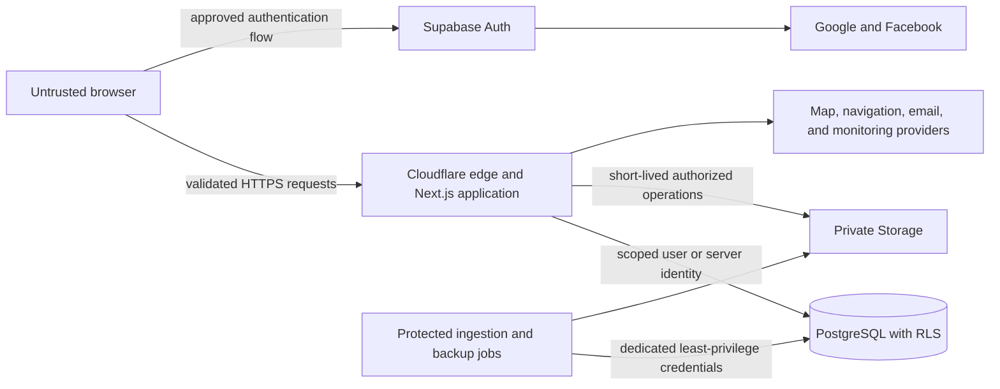
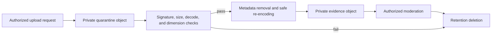

# Asa Ta Mangaon? Security and Privacy

## Document control

| Field | Value |
| --- | --- |
| Product | Asa Ta Mangaon? |
| Descriptor | Tagum Food Finder |
| Document status | Approved |
| Discovery status | Complete |
| Last updated | 2026-10-15 |
| Approved | 2026-10-13 |
| Target milestone | Private beta in February 2027 |
| Product owner | Repository owner |
| Build model | Solo-built |

This document defines the approved security, privacy, abuse-prevention, incident-response, and recovery requirements for the Tagum City private beta.

It implements the product scope in [`prd.md`](./prd.md), runtime boundaries in [`architecture.md`](./architecture.md), interface rules in [`design-system.md`](./design-system.md), and classifications and retention periods in [`data.md`](./data.md).

This is an engineering and operational specification, not legal advice. A qualified Philippine privacy review is a launch gate before real accounts, corrections, or evidence are collected.

## Security and privacy objectives

1. Keep public discovery useful without requiring identity.
2. Prevent one account from reading or changing another account's data.
3. Require stronger authentication and authorization for every administrative action.
4. Keep precise location transient and out of storage, analytics, logs, and error monitoring.
5. Treat submitted evidence as private, untrusted content throughout its lifecycle.
6. Preserve provenance and moderation integrity without retaining unnecessary identity.
7. Detect and contain abuse without building persistent behavioral profiles.
8. Recover the catalog and user workflows within the approved recovery targets.
9. Provide privacy information and controls that adults and minors can understand.
10. Maintain a security posture feasible for one developer and a ₱3,000 monthly operating ceiling.

## Assurance baseline

The implementation targets OWASP Application Security Verification Standard 5.0 Level 2. The complete standard is the verification reference; this document selects the requirements most material to the approved architecture.

The implementation also uses:

- the OWASP Cheat Sheet Series for authentication, sessions, uploads, logging, input validation, and incident response;
- official Supabase guidance for authentication, multi-factor authentication, row-level security, storage access, and production hardening;
- official Cloudflare guidance for Workers, security headers, rate limiting, and Turnstile;
- the Philippine Data Privacy Act of 2012, its Implementing Rules and Regulations, and current National Privacy Commission issuances.

References must be reviewed again before beta because platform behavior and regulatory guidance can change.

## Legal and privacy posture

### Controller and accountability

The person or registered business operating Asa Ta Mangaon? is the Personal Information Controller for app-controlled processing. Supabase, Cloudflare, Sentry, authentication providers, email services, GitHub, map services, and other vendors are processors, independent controllers, or service providers according to their actual role and terms.

The product owner is initially accountable for privacy and performs the DPO or equivalent compliance function unless professional advice requires a separate appointment. A dedicated public privacy contact using the product domain must exist before external beta invitations.

The owner maintains:

- a record of processing activities;
- the provider and subprocessor inventory;
- the data classification and retention schedule;
- privacy-impact assessments;
- data-subject request records;
- incident and breach registers;
- NPC registration or declaration records;
- material security and privacy exceptions.

### Regulatory launch gates

Before collecting real account or submission data, the owner must:

1. complete a documented Philippine privacy-law review;
2. determine whether the product and each processing system requires NPC registration;
3. register or submit the applicable declaration within the required period;
4. publish the controller identity and privacy contact;
5. approve the record of processing activities;
6. approve a privacy-impact assessment;
7. verify provider terms, processing regions, and data-processing agreements;
8. determine whether any child-accessible processing requires guardian authorization or additional safeguards;
9. implement those safeguards before enabling the affected processing;
10. preserve public discovery even if a registered feature must wait for legal readiness.

No document in this repository assumes an exemption from registration, child-protection duties, or data-subject rights.

### Lawful basis

Each purpose has its own documented lawful basis. The service does not use one blanket consent checkbox.

The provisional mapping for professional review is:

| Purpose | Provisional basis and requirement |
| --- | --- |
| Account creation and saved data | Necessary to provide the requested account service |
| Authentication-provider exchange | Necessary for the selected sign-in method; minimum scopes only |
| Correction follow-up | Necessary to provide the requested contribution workflow |
| Evidence supplied by the user | Specific informed agreement and rights confirmation, plus any child safeguard required by review |
| Security and abuse prevention | Legitimate interest supported by necessity and balancing records |
| Minimal first-party analytics | Legitimate interest supported by a balancing record and an accessible opt-out |
| Legal retention or disclosure | Applicable legal obligation, documented case by case |

If the legal review changes a basis, the record of processing activities, notice, controls, and retention behavior must change together.

### Privacy notices

The product uses layered, plain-English notices:

- a short just-in-time explanation before location permission;
- a short account notice before authentication;
- an evidence notice before upload;
- an analytics explanation and opt-out;
- a complete privacy notice linked from public and account surfaces;
- a child-readable version or presentation that does not require the user to disclose age.

Notices state the controller, purposes, data categories, bases, recipients, processing regions, retention, rights, contact, complaint route, and material automated processing. They avoid deceptive design, bundled choices, and claims that optional processing is required.

### Universal and minor access

All users, including minors, may use anonymous discovery and registered features. The service does not collect birth dates, age bands, school information, guardian identities, or proof of age as routine account data.

Because the service is likely to be accessed by minors:

- privacy and evidence explanations use concrete, age-appropriate language;
- privacy information appears at the point of collection;
- accounts have no public profile, public activity, messaging, follower, or social graph;
- the application does not build age-based or behavioral profiles;
- discovery history, dietary selections, religious attributes, and location are not linked to accounts;
- social providers are not used to import birthdays, friends, contacts, or profile content;
- data-subject rights may be exercised by the user or, where legally appropriate, a verified parent or guardian;
- verification of a guardian request is proportionate and is not stored beyond the request record;
- any guardian-authorization mechanism found necessary by legal review is implemented before the affected processing begins.

The app must not claim that a minor can independently provide legally sufficient authorization where governing law requires a guardian.

### Data-subject rights

The privacy channel and authenticated controls support:

- the right to be informed;
- access;
- correction;
- objection;
- withdrawal where processing depends on consent;
- portability;
- erasure or blocking where applicable;
- complaint escalation.

Requests are acknowledged within three business days and targeted for completion within 15 business days, unless the law requires a shorter period or a lawful extension applies.

Identity is verified through the signed-in account or verified email whenever possible. Government identification is not requested by default. If stronger proof is necessary, collect the minimum proof, restrict access, and delete it promptly after verification.

### Cookies and analytics choice

The beta uses only cookies required for authentication, security, session continuity, and user-requested preferences. A consent banner is not shown unless nonessential cookie or tracking technology is introduced.

First-party analytics has an accessible opt-out that works before and after sign-in. Analytics never attach an account ID, email, precise point, raw query, age, dietary history, or religious preference to an event.

## Threat model

### Protected assets

- user identities and sessions;
- favorites and saved wheel lists;
- private submissions and evidence;
- administrator identity and privileges;
- canonical place catalog and provenance;
- provider credentials and licenses;
- deployment, backup, and signing credentials;
- security, moderation, and incident records;
- application availability and cost quotas.

### Threat actors and failure sources

| Actor or source | Material risks |
| --- | --- |
| Anonymous abuser | Scraping, request floods, cost exhaustion, endpoint probing |
| Malicious account | Spam, fraudulent evidence, stored content attacks, quota abuse |
| Compromised user | Private-data access, false submissions, account deletion |
| Compromised administrator | Catalog corruption, evidence exposure, privilege abuse |
| Compromised provider | Data exposure, malicious responses, authentication or supply-chain failure |
| Poisoned place source | False locations, closures, prices, or unsafe links |
| Developer mistake | Secret exposure, incorrect RLS, unsafe deploy, destructive migration |
| Lost developer device | Dashboard, repository, secret, and backup-key exposure |
| Dependency attacker | Build or runtime compromise |
| Infrastructure failure | Data loss, prolonged outage, incomplete processing |

### Risk management

A maintained risk register records likelihood, impact, affected assets, current controls, residual risk, owner, due date, and last review. It is reviewed:

- before private beta;
- before public launch;
- after material architecture, provider, authentication, role, upload, or personal-data changes;
- after every significant incident;
- at least annually.

A STRIDE-style threat-model review is complete before authenticated, upload, and administrative features are released.

## Trust boundaries

The browser, provider responses, uploaded files, source data, URL parameters, and client claims are untrusted. Authentication does not make input trustworthy.

## Authentication

### User methods

Supabase Auth supports:

- a one-time magic link sent to a personal email address;
- Google sign-in;
- Facebook sign-in;

Passwords are not implemented. Additional providers require a separate scope, privacy, maintenance, and demand review.

OAuth requests use only the minimum identity and verified-email scopes needed for sign-in. The application does not request contacts, friends, posts, birthdays, photos, or advertising permissions.

Provider identities are not automatically linked merely because email strings match. Self-service identity linking is deferred because unsafe linking can enable account takeover. The UI explains that different sign-in choices may create separate accounts.

### Magic links

- Links are single-use and expire after 10 minutes.
- Request responses do not reveal whether an account exists.
- Redirect destinations use an exact environment allowlist.
- Production does not use wildcard callback origins.
- Magic-link parameters are excluded from logs and monitoring.
- Repeated requests are rate-limited by provider, account target, and network signal.

### Administrator identity

The administrator uses a dedicated Google identity reserved for administration. It is not an ordinary user account and does not use Facebook or magic-link sign-in for administrative access.

Administrative access requires:

- the dedicated allowlisted identity;
- an active administrator role stored under server control;
- Supabase Authenticator Assurance Level 2 using TOTP;
- strong MFA on the underlying Google account;
- recent authentication for high-impact actions;
- successful server and database authorization;
- an immutable audit event.

Recovery material is encrypted offline and stored separately from the daily device. There is no informal MFA bypass. A recovery action creates a critical security event and rotates affected credentials.

### Session policy

| Session | Idle limit | Absolute limit |
| --- | ---: | ---: |
| Registered user | 7 days | 30 days |
| Administrator | 30 minutes | 12 hours |

Sessions use the official Supabase server-rendering pattern or a Backend-for-Frontend pattern selected during the compatibility spike. Authentication material is never stored in `localStorage` or `sessionStorage`.

Cookies use HTTPS, `Secure`, `HttpOnly` where the chosen pattern permits, a narrowly scoped path and domain, and the strictest `SameSite` setting compatible with OAuth callbacks. State-changing routes also validate Origin and use anti-CSRF tokens.

Sensitive actions require recent authentication:

- account deletion;
- account export;
- identity or authentication changes;
- administrator role or MFA changes;
- canonical publish, merge, or destructive moderation;
- secret, provider, or backup configuration changes.

Users can revoke all sessions. Security incidents revoke affected sessions. Logout clears account-specific browser state and private caches without deleting anonymous preferences the user chose to retain.

## Authorization and RLS

### Principles

- Deny by default.
- Grant the narrowest operation and row scope.
- Enforce ownership in PostgreSQL, not only application code.
- Treat client role and object identifiers as untrusted.
- Require both role and assurance level for administrative writes.
- Keep the service role out of all browser-delivered code.
- Do not rely on hidden routes for protection.

### Roles

| Role | Access |
| --- | --- |
| `anon` | Approved public views and bounded discovery functions only |
| `authenticated` | Public reads plus records owned by the current account and approved submission operations |
| `administrator` | Moderation and catalog operations after server role and AAL2 checks |
| `service_role` | Narrow controlled jobs and server workflows only |

Administrator authorization is held in a server-controlled role table or protected application metadata. User-editable metadata is never an authorization source.

### Database exposure

- RLS is enabled on every table in an exposed schema.
- Base-table privileges are revoked when a view or function is the intended interface.
- Public views contain only fields approved for anonymous display.
- Account views filter by `auth.uid()` and do not accept an owner ID supplied by the client.
- Canonical writes occur through protected transactional functions or server workflows.
- Service-role use is isolated by function and environment.

Privileged `security definer` functions live in an unexposed schema, set an empty search path, schema-qualify every object, validate the caller, and expose no general SQL execution capability.

The implemented catalog importer follows this boundary: public RPC wrappers are executable only by `service_role`, delegate to narrowly scoped functions in `app_private`, and cannot be invoked by `anon` or `authenticated`. The staging transaction validates schema version, checksums, record limits, coordinates, and identifiers before writing. The publication transaction accepts only an awaiting-review batch and never publishes records marked for moderation.

### Policy testing

Every policy or role change tests:

- anonymous allow and deny cases;
- owner allow cases;
- another user's deny cases;
- administrator behavior with AAL1 and AAL2;
- service-job behavior;
- deleted, disabled, stale-token, and malformed-object cases;
- Storage object ownership and moderator access.

The application has no user-impersonation feature.

## Secrets and privileged access

### Storage and separation

Secrets live only in the relevant platform secret store or an ignored local environment file. They are never committed, placed in Obsidian notes, sent to clients, stored in analytics, or copied into logs.

Local, staging, and production have separate:

- Supabase projects and keys;
- OAuth applications and callback origins;
- storage buckets;
- Cloudflare configuration;
- Sentry projects or environments;
- email credentials;
- import credentials;
- backup credentials and destinations.

Deployment, runtime, ingestion, and backup use separate least-privilege identities where providers permit it.

### Inventory and rotation

The secret inventory records purpose, scope, environment, owner, creation date, rotation due date, storage location category, and revocation process.

High-privilege secrets rotate at least every 180 days and immediately after suspected exposure, provider-account changes, device loss, or a relevant incident. Short-lived or federated credentials are preferred where supported.

Repository and CI secret scanning is mandatory. If a secret reaches Git history, it is revoked first; deleting the text is not considered remediation.

### Developer device

The device used for production access requires:

- full-disk encryption;
- supported operating-system and browser patches;
- automatic screen lock;
- a non-shared OS account;
- password-manager-protected credentials;
- MFA on GitHub, Cloudflare, Supabase, domain, email, Google, Facebook, Sentry, and backup accounts;
- minimal browser extensions for the administrative profile.

Production dashboard access is reviewed quarterly.

## Web and PWA controls

### Implementation status before offline enablement

As of 2026-10-15, the production database enforces SSL, the production email provider requires confirmed addresses and stronger reauthentication, and the repository mirrors the approved password, OTP, and email rate-limit settings. Public catalog access is limited to the columns required by the security-invoker discovery views; internal release validation data and publisher identifiers are not granted to browser roles. The application sends an enforced baseline CSP, clickjacking protection, MIME-sniffing protection, a constrained referrer policy, and a permissions policy that limits geolocation to the app origin while denying camera and microphone access.

Offline caching remains disabled. The service worker is deliberately network-only until all of the following gates pass:

- the production domain and exact Supabase redirect allowlist are configured;
- authenticated routes are verified to return private, no-store cache policy through the production CDN;
- the offline fallback design is approved and implemented;
- the cache allowlist contains only versioned static assets and explicitly approved public catalog data;
- logout and deployment tests prove that no private or stale account data survives in Cache Storage;
- real-device update, rollback, storage-pressure, and offline tests pass.

HSTS is deferred until the production hostname and every intended subdomain are confirmed HTTPS-only. CAPTCHA is deferred until a production Turnstile site and secret exist. Database network restrictions are deferred until a stable deployment and emergency-administration access path is documented, to avoid locking out recovery access.

### Transport and headers

Production is HTTPS-only. HTTP redirects to HTTPS. HSTS starts with a short monitored duration, increases to at least one year after verification, and adds subdomains or preload only after every relevant hostname is ready.

Required response policy includes:

- nonce-based Content Security Policy introduced in report-only mode first;
- no `unsafe-eval` in production;
- `frame-ancestors 'none'` unless a reviewed embed need exists;
- `X-Content-Type-Options: nosniff`;
- `Referrer-Policy: strict-origin-when-cross-origin` or stricter;
- a Permissions Policy allowing geolocation only to the app origin and denying camera and microphone;
- exact CORS origins, methods, and headers;
- no wildcard origin with credentials.

Turnstile origins are added to CSP only when the challenge is enabled.

### Request and output safety

- Server inputs use versioned typed schemas and allowlists.
- Length, range, count, type, and state-transition constraints run server-side.
- Database access uses parameterized queries or typed clients.
- User text is rendered as text, not raw HTML.
- Rich HTML and embedded Markdown HTML are not accepted in the MVP.
- URL schemes and hosts are allowlisted by purpose.
- Google Maps and Waze destinations are built from controlled templates.
- Error responses do not expose stack traces, SQL, storage paths, provider responses, or account existence.

### Server rendering and caching

Each request receives a separate Supabase server client. User-specific responses are never placed in shared caches. Cache keys cannot be controlled to mix authenticated and anonymous responses.

The service worker never caches:

- authentication tokens or callbacks;
- authenticated HTML;
- private API responses;
- submissions or evidence;
- administrator data;
- signed evidence URLs.

Logout clears private caches. Versioned cache invalidation prevents old application code from indefinitely controlling the PWA.

## Location privacy

Location is requested only after a user gesture and a plain explanation. Denial never blocks manual discovery.

The selected point may be sent transiently to the discovery function so PostGIS can calculate proximity. The point:

- stays in browser memory only;
- is not stored in account or local storage;
- is not written to application logs, Sentry, analytics, submissions, or moderation records;
- is not included in cache keys visible to shared infrastructure;
- is discarded after the active experience no longer needs it.

The app sends external navigation services only the destination. The external service determines the origin under its own permission and privacy terms.

Analytics may record only outcomes such as location permission succeeded, location permission denied, or manual location used. Map and infrastructure providers may necessarily receive network address and map viewport; the privacy notice discloses this provider processing.

## Evidence upload security

### Upload flow

Upload authorization is short-lived and restricted to the current account, submission, random object prefix, allowed content class, and size. A client cannot select an existing object key or another user's prefix.

### Validation

The server or trusted processing worker verifies:

- JPEG, PNG, or WebP file signature;
- server-detected MIME type;
- maximum compressed size of 5 MB;
- successful full image decode;
- maximum decoded size of 20 megapixels;
- safe dimensions and aspect ratio;
- maximum five files per submission;
- expected ownership and submission state;
- duplicate content hash signals.

Accepted images are re-encoded into a safe supported format and EXIF is removed. Quarantine originals are inaccessible to moderators and deleted after successful transformation or rejection.

The beta does not support SVG, PDF, video, audio, archives, office files, or arbitrary binary content. Decode-and-re-encode is the primary active-content defense for the approved image-only scope. Malware scanning becomes mandatory before any other file type is considered.

### Access

Evidence buckets are private. Moderator access is checked at request time and uses signed URLs valid for no more than five minutes. Because signed URLs cannot be revoked before expiry, longer lifetimes are prohibited.

Re-encoded media is served with safe content type, `nosniff`, restrictive disposition where appropriate, and no active rendering context. Accepted evidence never becomes public media without a separate rights and publication decision.

## Abuse prevention

Rate limits combine endpoint, account, rotating network signal, session, and global volume. Shared mobile and household networks must not cause permanent bans.

| Operation | Initial control |
| --- | --- |
| Public discovery | Generous burst allowance, cache protection, and progressive response to sustained automation |
| Account and magic-link requests | Supabase limits plus network and target-address throttling |
| Correction submissions | 5 per hour and 20 per day per account |
| Evidence files | 20 per day per account in addition to submission limits |
| Account exports | 2 per day with recent authentication |
| Deletion requests | Idempotent workflow with recent authentication |
| Administrative sign-in | Strict provider limits, conditional challenge, alerting, and no permanent network-only block |

Submissions use a hidden honeypot, duplicate payload and evidence-hash checks, transactional quotas, and conditional Turnstile only after suspicious behavior. Normal discovery does not show a CAPTCHA.

Public facts cannot be made impossible to copy. The service controls abusive load, protects restricted provider data, and prohibits unauthorized bulk reuse in the terms. It does not collect invasive device fingerprints or create cross-site tracking identifiers.

Abuse indicators support moderation and security only. They are not contributor reputation scores and do not auto-publish or permanently reject corrections without review.

## Logging, monitoring, and alerting

### Logged events

Security logging includes:

- authentication success and failure categories;
- session revocation and sensitive reauthentication;
- authorization and RLS denial categories;
- administrator actions and role changes;
- submission and upload validation failure categories;
- rate-limit and Turnstile outcomes;
- import validation and publication;
- retention and account-deletion jobs;
- secret, provider, deployment, and backup configuration changes;
- backup completion and restore tests;
- incident containment actions.

Logs exclude:

- access and refresh tokens;
- cookies and session IDs;
- magic links and OAuth authorization codes;
- secrets and authorization headers;
- precise coordinates;
- raw request bodies;
- raw search terms;
- evidence objects, signed URLs, and storage paths;
- unnecessary email addresses;
- provider payloads containing personal or restricted data.

If session correlation is necessary, use a keyed, rotating correlation value rather than the token. Transient network addresses may support rate limiting. Raw application-owned security IP records are restricted and deleted within seven days; longer-lived records use an irreversible or rotating pseudonymous representation where it remains necessary.

Scrubbed security events are retained for 90 days. Immutable moderation and canonical audit history follows `data.md`. Sentry uses separate environments, minimized sampling, server-side scrubbing, and a maximum 30-day retention where the selected plan permits it.

### Alerts

The owner receives actionable alerts for:

- administrator login or MFA anomalies;
- repeated privileged authorization failures;
- suspected secret exposure;
- unusual submission or upload spikes;
- import validation or publication failure;
- account-deletion or retention-job failure;
- backup failure or stale backup age;
- authentication callback failure spikes;
- sustained unhandled server errors;
- quota and cost thresholds.

An alert must state the system, severity, first safe diagnostic action, and link to the applicable runbook without including secrets or personal content.

## Vendor and transfer management

Before production use, each provider record includes:

- role and purpose;
- data categories received;
- processing and storage regions;
- subprocessors;
- contract and data-processing terms;
- security documentation;
- breach-notification contact;
- deletion and export capability;
- outage and exit plan;
- last and next review dates.

Google and Facebook receive authentication requests only when chosen by the user. Navigation providers receive destination data only after the user requests directions. Sentry receives scrubbed technical events. Map providers receive only requests necessary to render the viewed map.

Provider terms and international-transfer safeguards are reviewed before beta and at least annually. A provider's certification does not replace application configuration or controller accountability.

## Backup and recovery

### Targets

| Measure | Target |
| --- | --- |
| Recovery point objective | Maximum 24 hours before real corrections are accepted |
| Public catalog recovery time | 24 hours |
| Complete moderation recovery time | 48 hours |

### Backup controls

- Create encrypted daily logical exports retained for 14 days.
- Create encrypted weekly exports retained for 12 weeks.
- Store backups outside the repository and outside the primary Supabase project.
- Use a dedicated least-privilege backup identity.
- Encrypt before transfer with a strong authenticated encryption tool.
- Keep recovery keys in the password manager plus separate offline recovery material.
- Never write backup secrets or plaintext exports to CI logs.
- Verify file existence, nonzero size, encryption, expected schema, and checksum.
- Exclude provider data that cannot lawfully be exported.

Restore testing occurs before beta, after a material backup-process change, and quarterly after public launch. Tests verify catalog release selection, PostGIS data, account ownership, provenance, moderation history, storage references, and deletion behavior.

A deletion ledger or equivalent tombstone process is applied after restoration so a backup cannot silently reactivate deleted accounts or private data. Historical backup expiry remains disclosed in the privacy notice.

## Incident response

### Severity

| Level | Example |
| --- | --- |
| Severity 1 | Confirmed or likely personal-data exposure, administrator compromise, active secret abuse, destructive catalog corruption, or unrecoverable data loss |
| Severity 2 | Contained privileged weakness, significant account compromise, malicious upload path, or major recoverable outage |
| Severity 3 | Limited user impact, repeated abuse, nonprivileged vulnerability, or partial provider degradation |
| Severity 4 | Suspicious event, blocked attempt, or low-risk control defect |

### Process

1. Record the report and establish an incident lead.
2. Preserve necessary evidence under restricted access.
3. Contain access, rotate secrets, revoke sessions, or stop publication as appropriate.
4. Determine affected systems, data, people, time window, and continuing risk.
5. Begin legal notification assessment immediately and target a documented decision within 24 hours.
6. Notify the National Privacy Commission and affected data subjects within the applicable 72-hour requirement when notification is required.
7. Recover from verified clean state and monitor for recurrence.
8. Complete a root-cause review with owners and verification dates.

Uncertainty about the exact record count does not justify waiting past a legal notification deadline. Initial notification may be updated as the investigation develops.

The incident register includes suspected incidents even when notification is not required. It records timeline, reporter, systems, data classes, containment, notification decision, communications, recovery, and corrective actions without copying unnecessary affected content.

### Required runbooks

- user account takeover;
- administrator or provider-account compromise;
- repository or secret exposure;
- RLS or private-storage exposure;
- malicious evidence upload;
- poisoned import or catalog corruption;
- provider breach or outage;
- accidental deletion or failed migration;
- lost developer device;
- backup or restore failure.

## Secure development lifecycle

### Source and deployment controls

- Production deploys originate from the protected main branch after required checks and explicit approval.
- Local direct production deployment is disabled where the platform permits.
- Agents never push automatically.
- Production data is never copied into local or staging environments.
- Staging uses synthetic or separately licensed data.
- Database migrations are tested before production.
- Destructive migration stages require a verified backup and roll-forward plan.

### Required continuous integration

- formatting and lint checks;
- TypeScript checks;
- unit, integration, and end-to-end tests appropriate to the change;
- production build;
- migration validation;
- RLS and storage policy tests;
- dependency vulnerability review;
- secret scanning;
- static security analysis;
- generated database-type consistency;
- repository checks that private artifacts and environment files are not tracked.

### Dependency response

Automated dependency updates are reviewed weekly.

| Severity | Response target |
| --- | --- |
| Known exploited or critical | Assess within one business day; mitigate or remediate within 72 hours |
| High | Assess within three business days; resolve within 14 days |
| Medium | Prioritize in the next planned maintenance cycle |
| Low | Track and address based on exposure and maintenance value |

If an update cannot be applied safely within the target, document compensating controls, owner, expiry, and verification.

The 2026-10-15 dependency audit identifies transitive advisories in the experimental Cloudflare/vinext deployment toolchain. The affected packages are build-time dependencies and are not required by the current Next.js runtime path, but npm does not currently offer a compatible automatic remediation. Before production deployment, either remove that unused adapter, replace it with a maintained deployment path, or upgrade to a release whose dependency tree passes the production audit. A forced downgrade is not an accepted remediation.

### Testing

Security verification includes:

- automated controls on every relevant change;
- manual OWASP-based testing before private beta;
- tests for IDOR, CSRF, XSS, injection, redirect abuse, OAuth callback abuse, session handling, RLS, upload bypass, cache leakage, and rate-limit concurrency;
- real-device geolocation and PWA cache testing;
- an independent security review before broad public launch.

No production release has a known unaccepted critical or high-risk vulnerability.

### Disclosure

Before public launch, publish:

- a monitored security email;
- `/.well-known/security.txt`;
- a coordinated-disclosure policy defining scope, prohibited destructive testing, safe-harbor intent, acknowledgement expectations, and remediation communication.

## Security exceptions

An exception records:

- the unmet control;
- reason and business need;
- affected data and systems;
- threat and worst credible impact;
- compensating controls;
- approver;
- expiry date;
- review and remediation owner.

Critical launch blockers cannot be waived for private beta:

- missing administrator MFA;
- untested RLS or Storage ownership boundaries;
- service-role material exposed to the browser;
- missing privacy notice or controller contact;
- missing regulatory applicability review;
- no working account deletion;
- no current recoverable backup;
- precise location present in persistent storage or logs;
- evidence stored publicly;
- a known exploitable critical or high-risk issue.

## Launch checklist

### Before private beta

- [ ] Complete the privacy-law and child-accessible-processing review.
- [ ] Complete NPC registration or the applicable declaration.
- [ ] Publish standard and child-readable layered privacy notices.
- [ ] Publish terms and evidence-rights language.
- [ ] Configure personal-email magic link, Google, and Facebook callback allowlists.
- [ ] Verify OAuth scopes request no social graph, contacts, birthday, or unnecessary profile data.
- [ ] Enforce dedicated administrator identity and AAL2.
- [ ] Test every RLS and Storage policy using the role matrix.
- [ ] Verify no authentication token uses browser web storage.
- [ ] Enforce CSP and security headers after report-only review.
- [ ] Validate location does not enter logs, analytics, Sentry, or storage.
- [ ] Test quarantine, decode, re-encode, EXIF removal, limits, and evidence authorization.
- [ ] Test rate limits under concurrent requests.
- [ ] Verify log and Sentry redaction with seeded canary values.
- [ ] Complete the threat model and risk register.
- [ ] Complete an OWASP-based manual security test.
- [ ] Generate and restore a current encrypted backup.
- [ ] Exercise account export, deletion, and restored-data deletion handling.
- [ ] Exercise one tabletop incident scenario and the 72-hour assessment workflow.
- [ ] Verify provider, domain, repository, and production dashboards use MFA.

### Before broad public launch

- [ ] Complete an independent security review.
- [ ] Publish `security.txt` and the coordinated-disclosure policy.
- [ ] Review provider regions, subprocessors, terms, and production pricing.
- [ ] Confirm quarterly restoration and access-review schedules.
- [ ] Reassess the risk register using observed beta abuse and incident data.
- [ ] Resolve every expired exception.

## Source references

- [Republic Act No. 10173, Data Privacy Act of 2012](https://privacy.gov.ph/data-privacy-act-/)
- [Implementing Rules and Regulations of the Data Privacy Act](https://privacy.gov.ph/implementing-rules%20regulations-data-privacy-act-2012/)
- [NPC Circular No. 2022-04 on registration](https://www.privacy.gov.ph/wp-content/uploads/2023/05/Circular-2022-04.pdf)
- [NPC Circular No. 2023-04 on consent](https://privacy.gov.ph/wp-content/uploads/2023/11/NPC-Circular-No.-2023-04_Guidelines-on-Consent_07Nov2023.pdf)
- [NPC child-oriented transparency FAQ](https://privacy.gov.ph/wp-content/uploads/2024/12/FAQs-Advisory-on-Guidelines-on-Child-Oriented-Transparency.pdf)
- [OWASP Application Security Verification Standard](https://owasp.org/projects/asvs?tab=main)
- [OWASP Cheat Sheet Series](https://cheatsheetseries.owasp.org/)
- [Supabase secure product configuration](https://supabase.com/docs/guides/security/product-security)
- [Supabase multi-factor authentication](https://supabase.com/docs/guides/auth/auth-mfa)
- [Supabase row-level security](https://supabase.com/docs/guides/database/postgres/row-level-security)
- [Supabase Storage access control](https://supabase.com/docs/guides/storage/security/access-control)

## Acceptance criteria

This security and privacy specification is approved because the product owner confirmed the complete discovery decision set with two explicit adjustments:

1. users authenticate with their own personal email or Google or Facebook identity;
2. users, including minors, can use anonymous and registered product features without an age gate.

Implementation must preserve the safeguards, legal launch gates, and data-minimization requirements in this document. Material changes to identity, public interaction, advertising, payment, business claims, messaging, age-related processing, or sensitive-data use require new privacy, threat-model, architecture, and data reviews before implementation.
